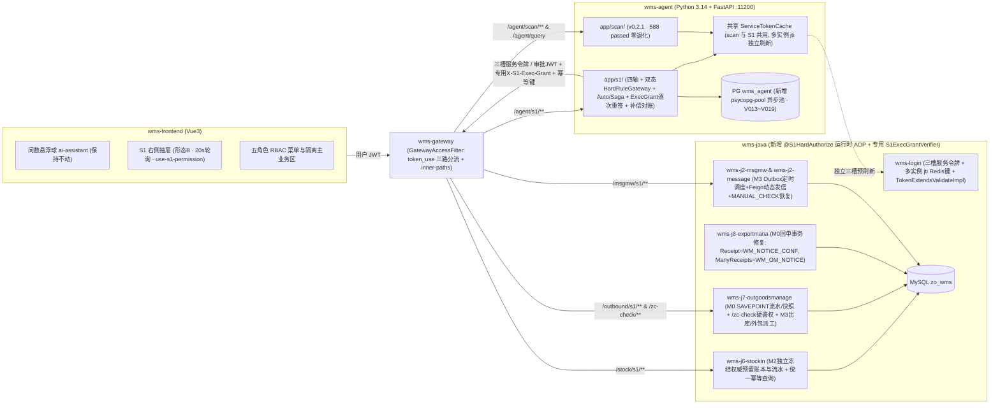

# 零壹 AI-Native WMS · S1 每日巡检与异常自愈 Agent 代码实施设计文档（v2.3-rc1）

## 1. 文档元信息、分阶段定稿状态与锁定底座

| 项目 | 说明 |
| :--- | :--- |
| **上游事实源** | `S1_每日巡检与异常自愈Agent_PRD_v1.0.md`（v1.0 评审版）、`s1_prototype_minimal_slice.html`（v3.1） |
| **架构与代码基线** | `zero-one-10wms/architecture.md`、ADR-001 ~ ADR-022；实证基线：**Python 588 passed / 12 skipped（600 total）**、**Java 18 类 116 tests**、**前端 4 文件 15 例**、**ADR-022 权限 baseline 349/349** |
| **版本定稿标记** | **`v2.3-rc1：M0 / M1a / M1b 开发基线定稿；M2 库存账本架构待冻结；M3 live 未放行`**（设计契约闭合 ≠ 代码已实现或真实 MySQL/PG/网关/浏览器运行证据通过） |

| 阶段 | 当前定稿状态 | 约束说明 |
| :--- | :--- | :--- |
| **M0** | **✅ 可定稿（开工基线）** | Day 0 流水/快照 + j7/j8 事务与 `SAVEPOINT` + `ops-start` 最小 `@S1HardAuthorize` 运行时 AOP |
| **M1a** | **✅ 可定稿（开发蓝图）** | 三槽多实例令牌 + 网关三路分流 + 完整 `ExecGrant` + 23 边状态机与接管重置规则 + `psycopg-pool` + 前端形态 B |
| **M1b** | **✅ 可定稿（仅限 dev 影子）** | 轴四只读/影子；不硬锁、不自动切线、`DEV_FIXTURE` 禁作生产验收证据 |
| **M2** | **🟡 不能定稿（库存架构待冻结）** | 须先独立评审并冻结 **§6.6 附录 F（库存状态机、库位/托盘双键、三方对账）** 及底座 B |
| **M3** | **🔴 不能定稿 / 禁切 live** | 强依赖 M2 冻结、7 项真实协议测试全绿及逐动作安全评审 |

### 1.1 已锁定架构底座（D1 ~ D8）
- **D1**：在现有 `wms-agent` 平滑演进（新增 `app/s1/` 与 `/agent/s1/**`，保留 `app/scan/` 与 588 passed 零退化，PG 迁移 `V013 ~ V019`）。
- **D2**：严守 ADR-005（Python 不直读 MySQL），业务流水落 MySQL 并经 `REPEATABLE READ` 快照端点拉取。
- **D3**：Python 持有 Saga 状态机与断点恢复台，经网关调 Java 幂等/补偿写端点。
- **D4**：抽象 `PolicyProvider` 端口，M1 先用 `YamlPolicyProvider`（ADR-018 canonical 快照冻结），M2 独立立项底座 B 上线后无缝切换 `GatewayPolicyProvider`。
- **D5**：纯 Python 轻量自研（兼容 Python 3.14），先做单领域 Agent（S1 暴露 `S1DomainService` 契约），全领域完成后再做顶层 Supervisor-Worker 编排。
- **D6**：前端复用 `wms-frontend`，**问数悬浮球（`components/ai-assistant/index.vue`）保持原样不动**，S1 新增形态 B 全局右侧抽屉 + 20s 轮询 + 服务端时间校准倒计时。
- **D7**：新增 ≤10 字符 `t_s_role.rolecode`（`s1_sup` / `s1_ops` / `s1_ldr` / `s1_cs`，管理层复用 `ckjl` / `gly`），数据范围落 PG 范围表，不动 `wms-oauth2` 登录 JWT 结构。
- **D8**：写动作按动作级独立控 `disabled | dry_run | live`（默认 `dry_run`），M3 逐动作安全评审放行切 `live`。

---

## 2. 三栈技术拓扑与代码层前置改造清单



### 2.1 代码实现层必须新建/重构的 4 项基础件（当前仓库尚不存在，纳入对应阶段实施任务）
1. **`@S1HardAuthorize` 运行时 AOP 切面（`wms-common` 新建，区别于静态 `@ResourcePermission`；分阶段交付）**：声明 `@Order(Ordered.HIGHEST_PRECEDENCE + 10)` **严格外包于 Spring `@Transactional`**（`@Order(LOWEST_PRECEDENCE)`）；严禁同 Service 类内 `this.method()` 自调用绕过 AOP 代理。
   - **M0 最小骨架**：上线用户 JWT 解析 + 角色/身份硬校验，立即保护 `POST /outbound/s1/ops-start`（不依赖 M1a）；
   - **M1a / M3 完整版**：叠加 `S1ExecGrantVerifier` 验签、RFC 8785 `target_scope_hash` 比对、班组/货主范围校验及 `s1_exec_grant_used` 防重放，覆盖 `/zc-check/**` 与全部 S1 写端点。
2. **三槽服务令牌与多实例防互踢改造（`wms-login` + `wms-gateway`）**：同步改造 `UserServiceImpl`、`AgentTokenSigner`、`TokenExtendsValidateImpl`、`GatewayAccessProperties`、`GatewayAccessFilter`；Redis 存储由单槽覆盖改为 **`agent:tok:{slot}:{jti}`（按 `jti` 独立存键带 TTL）**，多实例并发预刷新互不注销，`logout` 精准注销当前 `jti`。
3. **`wms-agent` PG 异步连接池依赖（`pyproject.toml` 新增）**：当前仓库 `app/storage/postgres.py` 为同步连接 + 线程卸载且未安装 `psycopg-pool`；M1a 在 `pyproject.toml` 显式引入 **`psycopg-pool>=3.2`**（同步更新 `uv.lock`）专供 `app/s1/repository.py` 全异步使用（不动旧 `app/scan/` 同步仓储），连接配置 `statement_timeout=2000ms`。
4. **Tick 分布式租约与 Advisory Lock 连接生命周期**：`agent_s1_tick_leases` 采用 `CAS + fencing_token + 30s 心跳续约`；如叠加 `pg_try_advisory_lock`，强制在同一 `async with pool.connection() as conn:` 上下文持有并在 `finally` 内显式 `pg_advisory_unlock`（杜绝连接还池未释放锁）。

**明确不动边界**：`/agent/query` 与 `app/agent/react.py`、`app/scan/` 既有路由与 600 条旧用例、`components/ai-assistant/index.vue`、`wms-oauth2` 登录 JWT 签发结构、`wms-cpp` 全部 16 个 C++ 服务（**含 C++ 计费 `wms-c5-costmanagement`**）。

---

## 3. 数据库设计与增量迁移（MySQL + PostgreSQL）

### 3.1 MySQL 增量脚本（目录：`documents/02、项目需求/数据库/`）

#### (1) M0 · Day 0 完整状态变更流水表：`migrate_s1_day0_ops_state_event.sql`
```sql
USE `zo_wms`;
SET NAMES utf8mb4;

CREATE TABLE IF NOT EXISTS `wm_ops_state_event` (
    `id`                  BIGINT        NOT NULL AUTO_INCREMENT COMMENT '自增主键',
    `event_id`            VARCHAR(40)   NOT NULL COMMENT '事件UUID',
    `biz_key_hash`        CHAR(64)      NOT NULL COMMENT 'SHA-256(Canonical JSON of wh/entity_type/entity_id/stage/action/attempt_seq/biz_seq)',
    `biz_key_raw`         VARCHAR(255)  NOT NULL COMMENT '可读业务键原文(截断留痕)',
    `warehouse_code`      VARCHAR(32)   NOT NULL DEFAULT 'W01' COMMENT '仓库编码',
    `stage`               VARCHAR(24)   NOT NULL COMMENT 'TASK_CONFIRM | DOWN_PICK | LOAD_RECHECK | RETURN_RECEIPT',
    `action`              VARCHAR(24)   NOT NULL COMMENT 'CREATED | ASSIGNED | STARTED | COMPLETED | REVERTED',
    `attempt_seq`         INT           NOT NULL DEFAULT 1 COMMENT '实体在本工序尝试序号(REVERTED后+1)',
    `start_source`        VARCHAR(20)   NOT NULL DEFAULT 'NA' COMMENT 'EXPLICIT_SCAN | INFERRED_ASSIGN | NA',
    `entity_type`         VARCHAR(24)   NOT NULL COMMENT 'WM_OM_QM_I | WM_TO_DOWN | WM_OM_DELV | WM_OM_NOTICE | WM_NOTICE_CONF',
    `entity_id`           VARCHAR(64)   NOT NULL COMMENT '任务/行项目/单据/回单实体主键',
    `order_id`            VARCHAR(64)   NOT NULL COMMENT '出库通知单号 om_notice_id',
    `wave_id`             VARCHAR(64)   NULL     COMMENT '波次号',
    `cus_code`            VARCHAR(32)   NULL     COMMENT '货主编码',
    `ocus_code`           VARCHAR(32)   NULL     COMMENT '三方客户/渠道映射码',
    `operator_id`         VARCHAR(64)   NULL     COMMENT '实际作业人账号',
    `proxy_by`            VARCHAR(64)   NULL     COMMENT '班组长/主管代报账号(非代报为NULL)',
    `team_code`           VARCHAR(32)   NULL     COMMENT '班组编码',
    `bin_area`            VARCHAR(32)   NULL     COMMENT '库区编码',
    `shift_code`          VARCHAR(16)   NOT NULL DEFAULT 'DAY' COMMENT 'DAY | NIGHT | PEAK_EXTRA',
    `is_peak_day`         TINYINT(1)    NOT NULL DEFAULT 0 COMMENT '峰值/大促日(1=是)',
    `sku_count`           INT           NOT NULL DEFAULT 1 COMMENT '本单SKU种数',
    `cross_zone_count`    INT           NOT NULL DEFAULT 1 COMMENT '跨库区数',
    `is_oversize`         TINYINT(1)    NOT NULL DEFAULT 0 COMMENT '大件/异形(1=是)',
    `complexity_bucket`   VARCHAR(16)   NOT NULL DEFAULT 'NORMAL' COMMENT 'SIMPLE | NORMAL | COMPLEX',
    `total_qty`           DECIMAL(14,3) NOT NULL DEFAULT 0 COMMENT '作业数量',
    `occurred_at`         DATETIME(3)   NOT NULL DEFAULT CURRENT_TIMESTAMP(3) COMMENT '精确业务时间',
    PRIMARY KEY (`id`),
    UNIQUE KEY `uk_ops_event_id` (`event_id`),
    UNIQUE KEY `uk_ops_biz_key_hash` (`biz_key_hash`),
    KEY `idx_ops_wh_stage_time` (`warehouse_code`, `stage`, `action`, `occurred_at`),
    KEY `idx_ops_wh_oper_time` (`warehouse_code`, `operator_id`, `stage`, `occurred_at`),
    KEY `idx_ops_entity_pair` (`entity_type`, `entity_id`, `stage`, `attempt_seq`, `action`),
    KEY `idx_ops_wave_bucket` (`wave_id`, `complexity_bucket`, `occurred_at`)
) ENGINE=InnoDB DEFAULT CHARSET=utf8mb4 COMMENT='S1 M0 出库与回单全工序状态变更流水表';
```

#### (2) M2 · 权威库存预留账本与流水（独立架构冻结草案，完整状态机与口径见 §6.6 附录 F）：`migrate_s1_m2_reservation_ledger.sql`
> [!WARNING]
> **M2 当前未定稿（待独立架构冻结）**：经源码核查，`wm_to_up_goods` 中 `bin_id` 是**托盘码**而非库位（库位是 `ku_wei_bian_ma`），下架 `wm_to_down_goods` 属于**源储位 → 目的/在途转移**而非最终出库扣减，`TaskConfirmServiceImpl.batchConfirmTask` 仅置 `bin_sta='Y'` 而非分配时点，且 C++ `AdjustlistDAO.cpp:148` 只改 `goods_qua` 不改 `base_goodscount`。因此以下 DDL 为 **按真实源码修正后的 M2 待冻结草案**，完整状态机、取消释放与三方对账规则见 **§6.6 附录 F**，冻结通过前禁止进入 M3 预留 live。

```sql
USE `zo_wms`;
SET NAMES utf8mb4;

CREATE TABLE IF NOT EXISTS `s1_stock_lot_balance` (
    `warehouse_code`         VARCHAR(32)   NOT NULL,
    `location_code`          VARCHAR(64)   NOT NULL DEFAULT '' COMMENT '库位编码(映射 wm_to_up_goods/wm_to_down_goods.ku_wei_bian_ma 与 wm_om_qm_i.bin_id; 在途虚拟位为 IN_TRANSIT)',
    `pallet_id`              VARCHAR(64)   NOT NULL DEFAULT '' COMMENT '托盘码(映射 wm_to_up_goods.bin_id / wm_to_down_goods.bin_id_from / wm_om_qm_i.tin_id)',
    `cus_code`               VARCHAR(32)   NOT NULL,
    `goods_id`               VARCHAR(64)   NOT NULL,
    `goods_batch`            VARCHAR(64)   NOT NULL DEFAULT '',
    `pro_data`               VARCHAR(32)   NOT NULL DEFAULT '',
    `storage_bucket`         VARCHAR(16)   NOT NULL DEFAULT 'ON_HAND' COMMENT 'ON_HAND(在库) | IN_TRANSIT(下架未回单在途)',
    `base_unit`              VARCHAR(32)   NOT NULL COMMENT '统一基本单位(所有数量按基本单位核算)',
    `lot_trust_level`        VARCHAR(16)   NOT NULL DEFAULT 'LEGACY' COMMENT 'HIGH | MEDIUM | LOW | LEGACY',
    `physical_qty`           DECIMAL(14,3) NOT NULL DEFAULT 0 COMMENT '当前库位+托盘实物基本单位数量',
    `reserved_high_qty`      DECIMAL(14,3) NOT NULL DEFAULT 0 COMMENT '高门槛渠道预留量(>2/3, 仅ON_HAND)',
    `reserved_mid_qty`       DECIMAL(14,3) NOT NULL DEFAULT 0 COMMENT '中门槛渠道预留量(>1/2, 仅ON_HAND)',
    `locked_temp_qty`        DECIMAL(14,3) NOT NULL DEFAULT 0 COMMENT '低可信/灰区临时锁定量(仅ON_HAND)',
    `allocated_outbound_qty` DECIMAL(14,3) NOT NULL DEFAULT 0 COMMENT '已生成待下架任务(wm_om_qm_i)分配占用量(仅ON_HAND)',
    `promo_lock_until`       DATETIME(3)   NULL,
    `ttl_expires_at`         DATETIME(3)   NULL,
    `reconcile_status`       VARCHAR(16)   NOT NULL DEFAULT 'OK' COMMENT 'OK | DRIFT_FROZEN(三方对账偏差自动熔断)',
    `version`                INT           NOT NULL DEFAULT 1,
    `updated_at`             DATETIME(3)   NOT NULL DEFAULT CURRENT_TIMESTAMP(3) ON UPDATE CURRENT_TIMESTAMP(3),
    PRIMARY KEY (`warehouse_code`, `storage_bucket`, `location_code`, `pallet_id`, `cus_code`, `goods_id`, `goods_batch`, `pro_data`),
    KEY `idx_lot_ttl` (`warehouse_code`, `storage_bucket`, `ttl_expires_at`),
    KEY `idx_lot_sku` (`warehouse_code`, `cus_code`, `goods_id`, `goods_batch`, `pro_data`),
    CONSTRAINT `chk_lot_qty_non_neg` CHECK (
        `physical_qty` >= 0 AND `reserved_high_qty` >= 0 AND `reserved_mid_qty` >= 0
        AND `locked_temp_qty` >= 0 AND `allocated_outbound_qty` >= 0
    ),
    CONSTRAINT `chk_lot_qty_conserve` CHECK (
        (`reserved_high_qty` + `reserved_mid_qty` + `locked_temp_qty` + `allocated_outbound_qty`) <= `physical_qty`
    )
) ENGINE=InnoDB DEFAULT CHARSET=utf8mb4 COMMENT='S1 M2 权威库位+托盘+批次库存预留余额表(待冻结草案,归属wms-j6)';

CREATE TABLE IF NOT EXISTS `s1_stock_reservation_ledger` (
    `ledger_id`       BIGINT        NOT NULL AUTO_INCREMENT,
    `biz_idem_key`    VARCHAR(128)  NOT NULL COMMENT '业务幂等键(防重复记账/重复释放)',
    `execution_id`    VARCHAR(40)   NULL     COMMENT 'S1执行ID(常规WMS作业可为空)',
    `order_id`        VARCHAR(64)   NULL     COMMENT '关联出入库单号',
    `warehouse_code`  VARCHAR(32)   NOT NULL,
    `storage_bucket`  VARCHAR(16)   NOT NULL DEFAULT 'ON_HAND',
    `location_code`   VARCHAR(64)   NOT NULL DEFAULT '',
    `pallet_id`       VARCHAR(64)   NOT NULL DEFAULT '',
    `cus_code`        VARCHAR(32)   NOT NULL,
    `channel_code`    VARCHAR(32)   NULL,
    `goods_id`        VARCHAR(64)   NOT NULL,
    `goods_batch`     VARCHAR(64)   NOT NULL DEFAULT '',
    `pro_data`        VARCHAR(32)   NOT NULL DEFAULT '',
    `op_type`         VARCHAR(24)   NOT NULL COMMENT 'PUTAWAY | ALLOCATE | RELEASE | TRANSFER_OUT | TRANSFER_IN | TRANSFER_REVERT | DEDUCT | RESERVE | TTL_RELEASE | TTL_RESTORE | LOCK | UNLOCK | RECONCILE_FIX',
    `delta_qty`       DECIMAL(14,3) NOT NULL COMMENT '本次变动基本单位数量',
    `base_unit`       VARCHAR(32)   NOT NULL,
    `operator_id`     VARCHAR(64)   NOT NULL,
    `created_at`      DATETIME(3)   NOT NULL DEFAULT CURRENT_TIMESTAMP(3),
    PRIMARY KEY (`ledger_id`),
    UNIQUE KEY `uk_ledger_biz_idem` (`biz_idem_key`),
    KEY `idx_ledger_exec` (`execution_id`),
    KEY `idx_ledger_lot` (`warehouse_code`, `location_code`, `pallet_id`, `cus_code`, `goods_id`, `goods_batch`, `created_at`)
) ENGINE=InnoDB DEFAULT CHARSET=utf8mb4 COMMENT='S1 M2 权威库存与预留不可变明细流水表(待冻结草案)';
```

#### (3) M3 · 执行安全表：`migrate_s1_m3_exec_safety.sql`
```sql
USE `zo_wms`;
SET NAMES utf8mb4;

CREATE TABLE IF NOT EXISTS `s1_idempotency_record` (
    `idempotency_key`  VARCHAR(128) NOT NULL COMMENT '正向: {exec_id}:{step_seq} | 补偿: comp:{exec_id}:{step_seq}',
    `service_name`     VARCHAR(32)  NOT NULL COMMENT 'j6 | j7 | msgmw',
    `endpoint`         VARCHAR(128) NOT NULL,
    `actor_id`         VARCHAR(64)  NOT NULL COMMENT '审批人ID / SYSTEM_AUTO / SYSTEM_FALLBACK',
    `request_hash`     CHAR(64)     NOT NULL COMMENT '请求体Canonical JSON SHA-256',
    `status`           VARCHAR(24)  NOT NULL COMMENT 'COMMITTED_PENDING_RESP(仅事务内暂态) | SUCCEEDED | COMPENSATED',
    `response_json`    MEDIUMTEXT   NULL,
    `created_at`       DATETIME(3)  NOT NULL DEFAULT CURRENT_TIMESTAMP(3),
    `updated_at`       DATETIME(3)  NOT NULL DEFAULT CURRENT_TIMESTAMP(3) ON UPDATE CURRENT_TIMESTAMP(3),
    PRIMARY KEY (`idempotency_key`),
    KEY `idx_idem_svc_status` (`service_name`, `status`, `updated_at`)
) ENGINE=InnoDB DEFAULT CHARSET=utf8mb4 COMMENT='S1 M3 先插后写唯一键阻塞幂等表(j6/j7/msgmw共用)';

CREATE TABLE IF NOT EXISTS `s1_idempotency_failure_log` (
    `idempotency_key`  VARCHAR(128) NOT NULL COMMENT '独立失败账本(主事务回滚后由外层事务落库,不随业务回滚消失)',
    `service_name`     VARCHAR(32)  NOT NULL,
    `endpoint`         VARCHAR(128) NOT NULL,
    `error_code`       VARCHAR(32)  NOT NULL,
    `error_message`    VARCHAR(512) NOT NULL,
    `created_at`       DATETIME(3)  NOT NULL DEFAULT CURRENT_TIMESTAMP(3),
    PRIMARY KEY (`idempotency_key`)
) ENGINE=InnoDB DEFAULT CHARSET=utf8mb4 COMMENT='S1 M3 不可重试业务终态失败独立账本';

CREATE TABLE IF NOT EXISTS `s1_exec_grant_used` (
    `jti`              VARCHAR(64)  NOT NULL,
    `execution_id`     VARCHAR(40)  NOT NULL,
    `action_code`      VARCHAR(48)  NOT NULL,
    `consumed_at`      DATETIME(3)  NOT NULL DEFAULT CURRENT_TIMESTAMP(3),
    `expires_at`       DATETIME(3)  NOT NULL,
    PRIMARY KEY (`jti`),
    KEY `idx_grant_exp` (`expires_at`)
) ENGINE=InnoDB DEFAULT CHARSET=utf8mb4 COMMENT='S1 M3 一次性执行授权防重放表';

CREATE TABLE IF NOT EXISTS `s1_notice_outbox` (
    `outbox_id`         VARCHAR(40)  NOT NULL,
    `idempotency_key`   VARCHAR(128) NOT NULL,
    `dedupe_window_key` VARCHAR(128) NOT NULL COMMENT '24h业务去重键: {cus}:{wave}:{tpl}:{yyyymmdd}',
    `execution_id`      VARCHAR(40)  NOT NULL,
    `cus_code`          VARCHAR(32)  NOT NULL,
    `channel`           VARCHAR(16)  NOT NULL COMMENT 'SMS | EMAIL | IN_APP',
    `template_code`     VARCHAR(64)  NOT NULL,
    `payload_json`      MEDIUMTEXT   NOT NULL,
    `status`            VARCHAR(16)  NOT NULL DEFAULT 'PENDING' COMMENT 'PENDING | SENDING | SENT | CANCELLED | MANUAL_CHECK | DEAD',
    `lease_owner`       VARCHAR(64)  NULL,
    `lease_until`       DATETIME(3)  NULL,
    `fencing_token`     BIGINT       NOT NULL DEFAULT 0,
    `provider_req_id`   VARCHAR(80)  NULL     COMMENT '内部关联请求号: {outbox_id}:f{fencing_token} (非provider幂等承诺)',
    `provider_biz_id`   VARCHAR(128) NULL     COMMENT '外部网关返回回执ID',
    `manual_evidence`   TEXT         NULL     COMMENT 'MANUAL_CHECK人工复核凭证',
    `retry_count`       INT          NOT NULL DEFAULT 0,
    `next_retry_at`     DATETIME(3)  NOT NULL DEFAULT CURRENT_TIMESTAMP(3),
    `created_at`        DATETIME(3)  NOT NULL DEFAULT CURRENT_TIMESTAMP(3),
    `updated_at`        DATETIME(3)  NOT NULL DEFAULT CURRENT_TIMESTAMP(3) ON UPDATE CURRENT_TIMESTAMP(3),
    PRIMARY KEY (`outbox_id`),
    UNIQUE KEY `uk_outbox_idem` (`idempotency_key`),
    UNIQUE KEY `uk_outbox_dedupe` (`dedupe_window_key`),
    KEY `idx_outbox_poll` (`status`, `next_retry_at`, `created_at`, `outbox_id`)
) ENGINE=InnoDB DEFAULT CHARSET=utf8mb4 COMMENT='S1 M3 客户通知Outbox表';

CREATE TABLE IF NOT EXISTS `s1_outsource_dispatch` (
    `dispatch_id`      VARCHAR(40)  NOT NULL,
    `execution_id`     VARCHAR(40)  NOT NULL,
    `warehouse_code`   VARCHAR(32)  NOT NULL,
    `wave_id`          VARCHAR(64)  NOT NULL,
    `headcount`        INT          NOT NULL,
    `duration_hours`   DECIMAL(6,2) NOT NULL,
    `unit_price`       DECIMAL(10,2) NOT NULL,
    `estimated_cost`   DECIMAL(12,2) NOT NULL,
    `status`           VARCHAR(16)  NOT NULL DEFAULT 'DISPATCHED' COMMENT 'DISPATCHED | CANCELLED | COMPLETED',
    `created_by`       VARCHAR(64)  NOT NULL,
    `created_at`       DATETIME(3)  NOT NULL DEFAULT CURRENT_TIMESTAMP(3),
    PRIMARY KEY (`dispatch_id`),
    UNIQUE KEY `uk_outsource_exec` (`execution_id`)
) ENGINE=InnoDB DEFAULT CHARSET=utf8mb4 COMMENT='S1 M3 归属wms-j7的外包派工台账(不侵入C++计费)';
```

---

### 3.2 PostgreSQL `wms_agent` 增量迁移（`V013` ~ `V019`，全配对 `.up/.down.sql`）

| 版本 | 表名 | v2.3 完整主键、唯一约束与不变量 |
| :--- | :--- | :--- |
| **`V013`** | `agent_s1_snapshots`<br>`agent_s1_tick_leases` | **快照表**：`snapshot_id PK`, `warehouse`, `tick_at`, `wip_payload JSONB`, `operator_rates JSONB`, `in_flight_tasks JSONB`, `slow_budget_hours JSONB`, `policy_version`, `policy_hash`, `policy_snapshot JSONB NOT NULL`, `capability_snapshot JSONB NOT NULL`, `expires_at TIMESTAMPTZ`（7 天热存）, `UNIQUE (warehouse, tick_at)`。<br>**节拍租约表**：`warehouse PK`, `lease_owner`, `fencing_token BIGINT NOT NULL DEFAULT 0`, `lease_until TIMESTAMPTZ`（CAS 抢占 + 30s 心跳续约 + 90s 崩溃自动释放） |
| **`V014`** | `agent_s1_cards`<br>`agent_s1_evidence_slices`<br>`agent_s1_evidence_archive` | **卡片表**：`card_id PK`, `snapshot_id TEXT NOT NULL`（无物理 FK 防阻塞 D+7 删快照；内嵌 `snapshot_summary JSONB`）, `warehouse`, `axis`, `card_type`, `priority`, `risk_level`, `origin_role`, `current_owner_role`, `current_owner_user_id`, `cus_code`, `team_code`, `fingerprint`, `state`, `version INT NOT NULL DEFAULT 1`, `evidence_checklist JSONB`, `evidence_complete BOOLEAN`, `formula_trace JSONB`, `plans JSONB`, `selected_plan_id`, `data_source_badge`, `escalate_at`, `fallback_at`, `claim_deadline_at`, `escalation_level`, `timeout_fallback_action`, `cooldown_until`, `verify_due_at`, `verify_status`。<br>**热/冷证据切片**：`UNIQUE (card_id, doc_id)`；D+90 迁至 `agent_s1_evidence_archive`，溯源接口热表未命中自动回落查归档表，输出前统一经 `clean_text` 净化 |
| **`V015`** | `agent_s1_card_events` | `event_id BIGSERIAL PK`, `card_id FK`, `from_state`, `to_state`, `actor_type`, `actor_user_id`, `actor_role`, `idempotency_token TEXT`, `UNIQUE (card_id, idempotency_token)`, `reject_category`, `site_causes JSONB`, `note`, `created_at` |
| **`V016`** | `agent_s1_executions`<br>`agent_s1_execution_steps` | **主表**：`execution_id PK`, `card_id FK`, `action_code`, `plan_id`, `trigger_channel`, `execution_mode`, `approver_user_id`, `approver_role`, `approval_snapshot_hash CHAR(64)`, `target_scope_hash CHAR(64)`（RFC 8785 Canonical JSON SHA-256）, `status` (`RUNNING \| SUCCEEDED \| PARTIAL_FAILED \| COMPENSATING \| COMPENSATED \| UNDONE \| FAILED_FINAL`), `undoable_until`, `hard_rule_report JSONB NOT NULL`；部分唯一索引 `uq_s1_active_exec_per_card (card_id) WHERE status IN ('RUNNING','PARTIAL_FAILED','COMPENSATING')`。<br>**步骤表**：`UNIQUE (execution_id, step_seq)` |
| **`V017`** | `agent_user_customer_scope`<br>`agent_user_team_scope` | **货主范围**：`scope_id BIGSERIAL PK`, `UNIQUE (user_id, warehouse, role_code, cus_code)`, `effective_from`, `effective_to`, `revoked_at`。<br>**班组范围**：`team_scope_id BIGSERIAL PK`, `UNIQUE (user_id, warehouse, team_code)`, `bin_areas JSONB`, `effective_from`, `effective_to`, `revoked_at` |
| **`V018`** | `agent_s1_runtime_guard`<br>`agent_s1_verify_samples`<br>`agent_s1_backtest_samples`<br>`agent_s1_metric_daily` | **熔断总闸**：`warehouse PK`, `degraded`, `degrade_reason`, `alert_rate_threshold`（默认 `30/min`）, `queue_backlog_threshold`（默认 `100`）, `recover_rate_threshold`（滞回默认 `<10/min`）, `recover_backlog_threshold`（滞回默认 `<30`）, `recover_hold_minutes`（默认 `10`）。<br>**对照组样本**：`UNIQUE (warehouse, cohort_key, source_ref_id)`；`cohort_key = {wh}:{axis}:{rule_type}:{stage}:{shift}:{complexity_bucket}:{load_band}:{policy_version}`。<br>**任务级回测样本表（消除波次压缩失真）**：`sample_id BIGSERIAL PK`, `warehouse`, `entity_type`, `entity_id`, `stage`, `attempt_seq`, `wave_id`, `complexity_bucket`, `predicted_duration_sec`, **`actual_duration_sec`（`occurred_at(COMPLETED) - occurred_at(STARTED)`，仅 `EXPLICIT_SCAN`）**, `is_peak_day`, `model_version`, `policy_hash`, `UNIQUE (warehouse, entity_type, entity_id, stage, attempt_seq)`。<br>**日聚合表**：`PRIMARY KEY (metric_date, warehouse)`，覆盖 §4.3 全部 12 项 KPI |
| **`V019`** | `agent_s1_capability_switches`<br>`agent_s1_capability_switch_audits` | **能力开关表**：`PRIMARY KEY (warehouse, capability_key)`, `maturity_stage CHECK IN ('cold_start','shadow','ready')`, `execution_mode CHECK IN ('disabled','dry_run','live')`, `heartbeat_granularity CHECK IN ('na','person_zone_soft','workstation_hard')`, `version INT NOT NULL DEFAULT 1`, `CONSTRAINT chk_live_requires_ready CHECK (execution_mode <> 'live' OR maturity_stage = 'ready')`, `exit_evidence JSONB`。<br>**切换审计表**：记录前/后态、操作人、退出证据哈希与时间 |

---

## 4. 性能预算、M2 退出证据协议、KPI 公式与专项测试门禁

### 4.1 15 秒单拍预算与熔断滞回
- **令牌预刷新脱离主拍**：`app/scan/` 与 `app/s1/` 共享单例 `ServiceTokenCache`（按 `slot + jti` 管理，独立协程提前 300s 预刷新）。
- **全异步 PG + 15s 硬预算**：`psycopg_pool.AsyncConnectionPool` + `statement_timeout=2000ms`；单拍总超时 `asyncio.timeout(15.0)`（快照 `≤4.0s` + PG 加载 `≤1.5s` + 算式/硬规则 `≤2.0s` + PG 落库 `≤2.5s` = 同步 `≤10.0s`；LLM 摘要完全异步剥离）。
- **整体降级总闸滞回规则**：任意连续 2 分钟满足 `告警产生速率 > 30 条/min` 或 `待处理决策队列 > 100 条` → 自动置 `degraded=true`（只采不推）；必须连续 **10 分钟**回落至 `< 10 条/min` 且队列 `< 30 条` 后，方可经仓经理确认或自动解除降级（防熔断抖动）。
- **前端时钟校准与断连保护**：`GET /agent/s1/drawer/feed` 必返 `serverNow` 校准倒计时；连续 2 次轮询失败切「数据已陈旧（只读）」红条并禁用全部审批按钮。

### 4.2 M2 退出证据可执行协议（TBD-1 / TBD-3 / TBD-4）
- **TBD-1（14 天任务级分桶工时回测）**：读 `agent_s1_backtest_samples`（仅 `actual_duration_sec` 来自 `EXPLICIT_SCAN` 配对的任务样本），校验全局 `explicit_scan_ratio >= 0.70`、跨度 `≥ 14 天`、含 `≥ 2` 个 `is_peak_day = 1` 班次，且 `SIMPLE / NORMAL / COMPLEX` **每个桶均满足 `n >= 100` 且 `MAPE = mean(|predicted - actual| / actual) < 0.20`**。
- **TBD-3（200 单抽检 & 7 天影子）**：分层随机抽 200 单（京东/猫超 ≥ 40%），双人复核总准确率 `≥ 98%` 且高门槛识别率 `≥ 99%`，叠加连续 7 天影子零严重漏保护。
- **TBD-4（底座 A 货值加权覆盖率 · 防扇出聚合）**：
  - **第一步（按批次先聚合可信度，防多收货行扇出重复计数）**：先对 `wm_in_qm_i` 按 `(warehouse_code, cus_code, goods_id, goods_batch, pro_data)` 分组求保守最低可信度 `lot_trust_level`（同批次若存在任一行 `RETURN` 或 `MANUAL` 或 `LEGACY`，整批不计为高可信；仅全行均属 `SCAN/QC` 才记为 `HIGH`）；
  - **第二步（1:1 关联 `s1_stock_lot_balance` × `md_goods.unit_cost_ref`）**：
    $$\text{Coverage}_{\text{val}} = \frac{\sum_{i \in \{\text{HIGH}\}} \text{physical\_qty}_i \times \text{unit\_cost\_ref}_i}{\sum_{i \in \text{All}} \text{physical\_qty}_i \times \text{unit\_cost\_ref}_i}$$
    缺失单价 SKU 占比 `cost_missing_ratio < 5%`；**T+60 ≥ 80%** 解除存量豁免，**T+120 ≥ 90%** 达稳态。

### 4.3 `agent_s1_metric_daily.metrics` 12 项 KPI 精确算式与合格线
1. `soft_heartbeat_fp_rate` = 误报核销数 ÷ 总红灯停摆卡（目标 `< 8%`，月 `n >= 30`）
2. `decision_adoption_rate` = 人工批准（含微调采纳）数 ÷ (批准 + 驳回) 总数（目标 `≥ 80%`）
3. `cooldown_repeat_rate` = 冷却期内重复弹出数 ÷ 总冷却次数（目标 `= 0%`）
4. `p0_mtta_sec` = `mean(first_claim_or_approve_at - created_at)`（目标 `≤ 300s`）
5. `p0_mttr_sec` = `mean(closed_healed_at - created_at)`（目标 `≤ 1500s`）
6. `net_heal_rate` = $\sum_c w_c \cdot \left[P(\text{rec}_{20\text{m}} \mid \text{intervened}, c) - P(\text{rec}_{20\text{m}} \mid \text{control}, c)\right]$（对照组 `n < 10` 标 `INSUFFICIENT_CONTROL`，目标 `≥ 40%`）
7. `damping_and_oscillation` = 全局单拍改判峰值 `≤ 10%` / 局部 `≤ 15%` / 调岗震荡熔断 `< 5%` 班次
8. `r3_timeout_fallback_ratio` = `FALLBACK_TRIGGERED` 数 ÷ 总 R3 卡数（目标 `< 5%`）
9. `verify_fail_ratio` = `ESCALATED_RELAPSE` 数 ÷ 总进入 `VERIFYING` 卡数（目标 `< 15%`）
10. `reservation_pair` = 命中率 `80% ~ 92%` **且** 高门槛缺供率 `< 3%` **且** TTL 呆滞率 `< 2%`
11. `expiry_health` = 货值加权覆盖率（T+60 `≥ 80%` / T+120 `≥ 90%`）**且** 清货挽回率 `≥ 70%`
12. `penalty_per_10k_orders` = 实发罚金总额 ÷ (总单量 / 10000)（较基线下降 `≥ 30%`）+ 四类驳回归因分布

### 4.4 工程门禁与 7 项协议级必测用例
- `init.sh --java-test` 增补：`wms-j7-outgoodsmanage`、`wms-j8-exportmana`、`wms-j2-msgmw`、`wms-j2-message`；前端 CI 执行 `corepack pnpm exec vitest run` + `corepack pnpm build`；Python 零退化底线 **588 passed / 12 skipped**。
- **新增 7 项真实协议必测用例**（未绿禁切对应阶段）：
  1. **幂等并发撞键与锁超时**：双线程同 `idempotency_key` 并发打 Java 写端点 → 仅执行 1 次业务写、败者返缓存 200；锁等待超时返 409；
  2. **超时 `NOT_FOUND` 在途重试**：首事务未提交时对账返 `NOT_FOUND`，带原键+新 `jti` 重试后不重复落业务；
  3. **跨库补偿异步对账**：模拟 MySQL 补偿提交成功但 PG 更新失败 → `S1CompensationReconciler` 60s 内自动将 PG 收敛为 `COMPENSATED` 且 `/resume` 返 409；
  4. **Outbox 崩溃与人工恢复**：模拟 `SENDING` 租约过期 → 自动转 `MANUAL_CHECK`（绝不盲发）→ `/resolve-manual` 校验权限与 `RETRY_ONCE` 递增 `fencing_token`；
  5. **三槽多实例并发刷新**：双实例同时预刷新 `insp_read`/`s1_auto` 令牌 → 不同 `jti` 互不注销，注销单个 `jti` 不影响另一实例；
  6. **专用 `S1ExecGrantVerifier` 双密钥轮换**：`current/previous` `kid` 切换期间平滑验签，非法 `target_scope_hash` 强拒 403；
  7. **SAVEPOINT 原子性验证**：模拟主业务写后抛异常回滚 → `wm_ops_state_event` 零残留；模拟仅事件表约束异常 → 主业务正常提交且写降级告警指标。

---

## 5. 六阶段放行路线与可执行回滚预案

| 阶段 | 定稿状态与放行范围 | 强制可执行回滚预案 |
| :--- | :--- | :--- |
| **M0 · Day0 流水与快照** | **✅ 可定稿**：`wm_ops_state_event`（SAVEPOINT + 全局锁序 + `attempt_seq`/`proxy_by`/`biz_key_hash` + j7 事务修 + j8 `Receipt`/`ManyReceipts` 事务修）+ **`wms-common` 最小 `@S1HardAuthorize` 运行时 AOP（保护 `POST /outbound/s1/ops-start`）** + `GET /outbound/s1/ops-snapshot` + 网关白名单与种子。 | 置 `s1.event.enabled=false` 秒停写流水（零影响主业务）；保留事务修复与已采样本。 |
| **M1a · 主动巡检最小闭环** | **✅ 可定稿**：三槽令牌（多实例 `jti`）+ 网关三路分流 + 共享 `ServiceTokenCache` + `@S1HardAuthorize` 扩展 `S1ExecGrantVerifier`/范围哈希 + `/zc-check/**` 后端鉴权 + `psycopg-pool` + PG `V013~V019` + 轴三三条件软心跳（含 IT 抄送）+ 冷启动轴一/二 + 23 边 CAS 状态机与接管重置规则 + 双态 `HardRuleGateway` + `dry_run` 人工/自动双通道 + 五角色主区与形态 B 抽屉（保留问数悬浮球）+ `menu-access.ts`/`use-s1-permission.ts`。 | 1. 拉响 `agent_s1_runtime_guard.degraded=true` 停发新卡；2. 停 5min 节拍任务；3. 前端关特性开关隐藏抽屉；4. 审计数据完整保留。 |
| **M1b · 轴四 dev 影子** | **✅ 可定稿（仅限 dev 影子）**：轴四只读/影子（强标 `MANUAL_CONSERVATIVE` / `DEV_FIXTURE`；**不硬锁、不自动切线、`DEV_FIXTURE` 禁作生产验收证据**）。 | 将 `axis4_*` 置 `disabled`，保留观察记录。 |
| **M2 · 底座 B 与权威库存账本** | **🟡 待冻结（当前未定稿）**：独立立项交付底座 B（切 `GatewayPolicyProvider`）+ **独立评审并冻结 §6.6 附录 F（库位+托盘双键、完整库存状态机、`ALLOCATE/RELEASE/TRANSFER/DEDUCT`、取消冲销与三方对账）** + 补 `channel_code`/底座 A/排班技能表 + 跑完 §4.2 全部 TBD-1/3/4 退出证据 → 正式冻结 `S1 v1.0 · 运行态`。 | `PolicyProvider` 一键切回 `YamlPolicyProvider`；库存账本回退前强制执行一次全量三方对账快照归档。 |
| **M3 · 逐动作安全评审切 `live`** | **🔴 未放行（当前未定稿）**：落库 `migrate_s1_m3_exec_safety.sql` + 落地 §6.2~§6.5 全部安全契约（含 Outbox 退避/`DEAD` 与 `GET .../idempotency/{key}` 白名单）与 7 项协议测试；**按单动作逐个安全评审切 `live`**（受 `CHECK(live ⇒ ready)` 强约束）。 | 1. 单动作立即切 `execution_mode=dry_run` 阻断新执行；2. 在途执行受单步 **10s HTTP 硬超时** 截断，未决者自动落 `PARTIAL_FAILED` 进恢复台人工冲销；3. `s1_notice_outbox` 的 `PENDING` 条件置 `CANCELLED`，在途 `SENDING` 全部转 `MANUAL_CHECK` 交人工核查；4. 幂等/审计/账本表永不删。 |
| **后续独立排期** | 底座 C（平台 ASN 三段 P90/P95）、工位硬心跳（TBD-2）、独立物理安全急停旁路、顶层 Supervisor-Worker 编排与被动问数复用快照。 | 独立立项与评审。 |

---

## 6. 执行安全附录（6 份刚性工程契约）

### 6.1 附录 A（契约 1）：全局唯一锁序、SAVEPOINT 边界、Day0 身份与回单埋点

1. **全系统唯一全局资源锁序（消除 j6/j7 锁序反转死锁）**：
   所有涉及 S1 写操作的 MySQL 事务严格按以下顺序获取行锁：
   1. **`s1_idempotency_record`**（先插唯一键门闩，仅 M3 写端点）；
   2. **`s1_exec_grant_used`**（同事务插 `jti` 防重放，仅 M3 写端点）；
   3. **`s1_stock_lot_balance`**（若涉及库存预留/转移/扣减，按 `(warehouse_code, storage_bucket, location_code, pallet_id, cus_code, goods_id, goods_batch, pro_data)` 字典序 `SELECT ... FOR UPDATE`）；
   4. **业务主表行**（`wm_om_qm_i` / `wm_to_down_goods` / `wm_om_notice_h` / `wm_notice_conf`，按主键 `id ASC FOR UPDATE`）；
   5. **纯追加事件/Outbox 表**（`wm_ops_state_event` / `s1_stock_reservation_ledger` / `s1_notice_outbox`）。
2. **同连接 `SAVEPOINT` 原子性与连接失效边界**：
   - `@S1HardAuthorize` AOP（`@Order(HIGHEST_PRECEDENCE+10)`）包住 `@Transactional`；事件记录与主业务共享同一 JDBC Connection，主表写入后建 `SAVEPOINT sp_s1_event` 写入 `wm_ops_state_event`；
   - 主事务回滚 → 事件自动同回滚（零假样本）；事件命中 `uk_ops_biz_key_hash` → 幂等忽略；事件抛非唯一键 SQL 异常且 `s1.event.fail-open=true` → 仅 `ROLLBACK TO SAVEPOINT` 并在 `TransactionSynchronization.afterCommit` 记错误日志与告警指标；
   - **连接失效边界明确**：若执行 `ROLLBACK TO SAVEPOINT` 时底层 JDBC 连接已断开而抛异常，主事务本身亦会随断连整体回滚，此时按主事务失败上报异常——**`fail-open` 仅覆盖连接存活时的事件写异常，绝不伪造已断连事务的成功**。
3. **事件唯一身份、真实变更 ID 与 j8 回单区分**：
   - `biz_key_hash = SHA-256(CanonicalJSON({wh, entity_type, entity_id, stage, action, attempt_seq, biz_seq}))`；`attempt_seq` 取该实体本工序已 `REVERTED` 次数 + 1；
   - `TaskConfirmServiceImpl` 批量更新前先按 `id ASC FOR UPDATE` 查真实待变更行，仅对真实跃迁行写事件并保持 `1/-1` 返回；
   - `LoadCheckController.oneClickReview` 下沉 Service 事务；`wms-j8-exportmana` 补事务与回单埋点，按真实实体表区分：**`ReceiptServiceImpl` 记 `WM_NOTICE_CONF`，`ManyReceiptsServiceImpl` 记 `WM_OM_NOTICE`**；
   - `POST /outbound/s1/ops-start` 强鉴权 + 前置状态守卫 + 班组长代报落 `proxy_by` + 前端下架/拣货/复核页面自动埋点。

---

### 6.2 附录 B（契约 2）：三槽多实例令牌、网关三路分流与专用 `S1ExecGrantVerifier`

1. **`wms-login` 三槽多实例服务令牌（同步改 `UserServiceImpl` / `AgentTokenSigner` / `TokenExtendsValidateImpl`）**：
   - 按 `X-Agent-Key-Id` 独立签发 3 类令牌：`insp_read` (`token_use=agent_service`)、`s1_auto` (`token_use=agent_auto_exec`)、`s1_fallback` (`token_use=agent_fallback_exec`)；
   - Redis 按 **`agent:tok:{slot}:{jti}`** 独立存键带 TTL（多实例刷新互不踢人，`logout` 精准注销当前 `jti`）；Python `app/scan/` 与 `app/s1/` 共享单例 `ServiceTokenCache`。
2. **`wms-gateway` (`GatewayAccessFilter.decide()`) `token_use` 三路硬分流**：
   - 识别上述全部 3 类 `token_use`，绝不落入普通用户或 `audit-authorization=true` 放行分支：
     - `agent_service`（`insp_read`）→ 仅 `service-token-paths`（只读；**显式包含 `GET /outbound/s1/ops-snapshot` 及 3 个幂等只读对账端点 `GET /stock/s1/idempotency/{key}`、`GET /outbound/s1/idempotency/{key}`、`GET /msgmw/s1/idempotency/{key}`**）；
     - `agent_auto_exec` → 仅 `auto-exec-token-paths`（白名单 R1/R2，物理拒绝一切 R3）；
     - `agent_fallback_exec` → 仅 `fallback-exec-token-paths`（仅 `/outbound/s1/lot/gray-hold` 等保守可逆兜底，物理拒绝放行/拆单/通知/清货转储）；
   - `inner-paths` 增补 `"/agent/s1/**"`；Python 硬拒所有 3 类服务令牌访问面向人类的 `/agent/s1/**` 端点（403）。
3. **专用 `S1ExecGrantVerifier`（严禁复用 `JwtComponent`）与规范化范围哈希**：
   - `wms-common` 新建标准 **`S1ExecGrantVerifier`**（标准 HMAC-SHA256、Unix **秒** `exp`、`kid` 双密钥 `current/previous` 轮换；明确信任边界：共享 HMAC 密钥仅下发至 `wms-agent` 与 `wms-java` 后端容器环境变量，永不暴露前端或入库）；
   - 范围哈希采用 **RFC 8785 Canonical JSON** 序列化 `{"warehouse": "...", "cusCodes": [...], "entityIds": [...]}` 后取 SHA-256（杜绝字符串拼接碰撞）；
   - 审批事实持久化在 PG `agent_s1_executions` 后，**每次正向步、`/resume`、`/compensate`、`/undo` 均实时重签一枚新的 60s 一次性 `X-S1-Exec-Grant(jti)`**；Java `@S1HardAuthorize` 在事务外层验 JWT + 验 `S1ExecGrantVerifier` + 比对请求体计算出的 `target_scope_hash`，并在事务内插 `s1_exec_grant_used(jti)` 防重放。

---

### 6.3 附录 C（契约 3）：先插后写唯一键幂等、跨库补偿对账与 Outbox 协议

1. **「先插门闩、再写业务」终态幂等协议**：
   - 事务内严格顺序：**① `INSERT s1_idempotency_record(status='COMMITTED_PENDING_RESP')` 抢占唯一键门闩 → ② 写业务主表 → ③ `UPDATE s1_idempotency_record SET status='SUCCEEDED', response_json=?` → ④ `COMMIT`**；
   - 并发败者被第 ① 步唯一键行锁阻塞在业务写之前，首事务提交后立即命中 `DuplicateKeyException` → 查已提交记录比对 `request_hash`（一致返 200 缓存响应，不一致返 422），**零重复业务副作用**；锁等待超时返 `HTTP 409 RETRY_LATER`；
   - **不可重试失败独立落账**：业务抛出确定性不可重试异常时主事务回滚，由外层独立事务写入 `s1_idempotency_failure_log`（不随业务回滚消失）；
   - **`NOT_FOUND` 在途重试与统一查询端点**：j6（`/stock/s1/idempotency/{key}`）、j7（`/outbound/s1/idempotency/{key}`）、msgmw（`/msgmw/s1/idempotency/{key}`）均提供只读对账端点；超时后对账返回 `NOT_FOUND` 表示“已回滚 OR 仍在途”，Python 必须以**原幂等键 + 新 `jti`** 退避重试（绝不误判失败）；
   - **跨库补偿与 `S1CompensationReconciler` 对账**：补偿调用独立键 `comp:{exec_id}:{step_seq}` + 新 `jti`，补偿事务内同步将正向 `s1_idempotency_record` 置 `COMPENSATED`；PG 侧先置 `COMPENSATING`，后台 **`S1CompensationReconciler`** 每 60s 对账 MySQL 补偿幂等键将 PG 收敛为 `COMPENSATED`，`/resume` 强守卫 `status == 'PARTIAL_FAILED'` 物理禁止旧 Saga 续跑。
2. **Outbox 同事务抢占、条件取消与 At-Least-Once 声明**：
   - `wms-j2-msgmw` 开启 `@EnableScheduling` + `@EnableFeignClients`，新增 `S1OutboxWorker` 与签名认证 `MessageS1FeignClient` 对接 `wms-j2-message` 的 `POST /message/s1/send`；
   - **同事务抢占**：同一 `@Transactional` 内执行 `SELECT outbox_id FROM s1_notice_outbox WHERE status='PENDING' AND (next_retry_at IS NULL OR next_retry_at <= NOW(3)) ORDER BY created_at ASC, outbox_id ASC LIMIT 20 FOR UPDATE SKIP LOCKED` 并立即 `UPDATE ... SET status='SENDING', lease_owner=?, lease_until=NOW(3)+INTERVAL 60 SECOND, fencing_token=fencing_token+1, provider_req_id=CONCAT(outbox_id,':f',fencing_token)`（注：MySQL `UPDATE SET` 从左到右求值，`provider_req_id` 引用递增后的 `fencing_token`）；
   - **防竞态取消**：`/cancel` 必须执行 `UPDATE s1_notice_outbox SET status='CANCELLED' WHERE outbox_id=? AND status='PENDING'`，受影响行数 = 0 时返 409；
   - **普通发送失败退避与 `DEAD` 转换**：当下游 `wms-j2-message` 返回明确可重试失败（HTTP 5xx / 限流 / 连接拒绝，确定未送达）且持有当前 `fencing_token` 时，递增 `retry_count = retry_count + 1`：
     - 若 `retry_count < 5`：置回 `status='PENDING'`、`lease_owner=NULL`、`lease_until=NULL`、`next_retry_at = NOW(3) + INTERVAL (30 * POW(2, retry_count - 1)) SECOND`（30s → 60s → 120s → 240s，叠加 ±10% 抖动）；
     - 若 `retry_count >= 5` 或返回确定性不可重试业务错误（如手机号非法 / 模板不存在）：置 **`status='DEAD'`**，记录错误摘要并推客服/运营人工补发工单；
   - **投递语义与崩溃未知态恢复**：明确外部短信通道为 **At-Least-Once（`provider_req_id` 为内部关联号，不宣称外部 provider 幂等）** + 24h `dedupe_window_key` 去重；回写 `SENT` 必带 `WHERE outbox_id=? AND status='SENDING' AND fencing_token=?`；与明确失败严格区分，**过期 `SENDING`（已发出去但结果未知）严禁自动重试一律转 `MANUAL_CHECK`**，由 `s1_cs`/`ckjl`/`gly` 调 `/resolve-manual`（必填 `manual_evidence`；选 `RETRY_ONCE` 时强制递增 `fencing_token` 生成新 `provider_req_id` 再重置 `PENDING`）。

---

### 6.4 附录 D（契约 4）：全量 23 边 CAS 状态迁移基线与全 9 类卡片 SLA 矩阵

#### 1. 独立完整 23 条状态迁移基线（全部带 `WHERE card_id=? AND state=? AND version=?` 乐观锁）

| # | 原状态 | 目标状态 | Actor | 守卫 (Guard) | 副作用 |
| :-: | :--- | :--- | :--- | :--- | :--- |
| 1 | `[*]` | `OBSERVING` | `SlowTick` | 早期效期/低紧迫未达待办窗 | 静默入观察池 |
| 2 | `OBSERVING` | `PENDING_ACTION` | `SlowTick/Tick` | 跨入清货窗或风险恶化 | 置 `escalate_at`/`fallback_at`，推抽屉 |
| 3 | `OBSERVING` | `CLOSED_EXITED` | `SlowTick` | 自然售罄或清货窗关闭 | 静默退场归档 |
| 4 | `[*]` | `PENDING_ACTION` | `TickEngine` | 命中阈值且不在冷却期；过 `HardRuleGateway` | 落卡+原始证据切片+SLA 计时 |
| 5 | `PENDING_ACTION` | `ESCALATED` | `TimeoutWatcher` | `now >= escalate_at && escalation_level == 0` | `level=1`，抄送/转交上级 |
| 6 | `ESCALATED` | `PENDING_ACTION` | 上级/替补岗 (`/takeover`) | 上级/替补接手认领该升级卡 | 更新 `current_owner`；保持 `escalation_level=1`、`escalate_at=NULL`、重置 `fallback_at=now+二阶段增量时长` |
| 7 | `ESCALATED` | `FALLBACK_TRIGGERED` | `TimeoutWatcher` | `now >= fallback_at && escalation_level == 1` | 执行分级兜底（见表 2），标红推 `ckjl` |
| 8 | `FALLBACK_TRIGGERED` | `PENDING_ACTION` | `ckjl/gly` (`/takeover`) | 仅仓经理/运营总监 | `owner=ckjl`；置 `escalation_level=2`、`escalate_at=NULL`、重置 `fallback_at=now+30m`（仅记管理层超时告警，不再重复兜底） |
| 9 | `FALLBACK_TRIGGERED` | `CLOSED_MANUAL` | `ckjl/gly` (`/close`) | 必填追责结案说明 | 核销归档 |
| 10 | `PENDING_ACTION / ESCALATED` | `REJECTED_COOLDOWN` | 主责角色 (`/reject`) | 必传四选一 `rejectCategory` | 写 `cooldown_until=now+30m` |
| 11 | `REJECTED_COOLDOWN` | `PENDING_ACTION` | `TickEngine` | `now >= cooldown_until` 且异常仍存在 | 重新唤醒待处置 |
| 12 | `REJECTED_COOLDOWN` | `CLOSED_CLEARED` | `TickEngine` | 冷却期内异常消解或误报核销 | 结案归档 |
| 13 | `PENDING_ACTION / ESCALATED` | `CLAIMED` | `s1_ldr` (`/claim`) | 仅 `STALL_LEADER`（`s1_sup` 403） | 停认领计时，启 `claim_deadline_at=now+30m` |
| 14 | `CLAIMED` | `ESCALATED` | `TimeoutWatcher` | `now >= claim_deadline_at` 未上报根因 | 恢复升级 `s1_sup` |
| 15 | `CLAIMED` | `VERIFYING` | `s1_ldr` (`/report-cause`) | 必传中性多选 `causes[]` | 置 `verify_due_at=now+20m` |
| 16 | `PENDING_ACTION / ESCALATED` | `EXECUTING` | 主责 (`/approve`/`/redecide`) 或 `AutoActionExecutor` | **通过当前策略二次 `HardRuleGateway`** + `evidence_complete=true` | 建 `execution_id` 启 `SagaRunner` |
| 17 | `EXECUTING` | `PARTIAL_FAILED` | `SagaRunner` | 同步步骤重试 3 次或对账失败 | 冻结后续步，开放恢复台 |
| 18 | `EXECUTING / PARTIAL_FAILED` | `VERIFYING` | `SagaRunner` / `/resume` | 全部同步步成功（Outbox 已入队） | 置 `verify_due_at=now+20m` + 执行后冷却 |
| 19 | `PARTIAL_FAILED` | `PENDING_ACTION` | `s1_sup/ckjl` (`/compensate`) / `Reconciler` | 全部已成步逆序补偿成功并对账收敛 | 标记执行 `COMPENSATED`，退回重选方案 |
| 20 | `VERIFYING` | `CLOSED_HEALED` | `Verifier` | `now >= verify_due_at` 且指标达标 | 记净自愈正样本并归档 |
| 21 | `VERIFYING` | `ESCALATED_RELAPSE` | `Verifier` | `now >= verify_due_at` 且指标未恢复 | 停摆推 `s1_sup` 复发卡；作业类强推 `ckjl` |
| 22 | `ESCALATED_RELAPSE` | `PENDING_ACTION` / `CLOSED_MANUAL` | `s1_sup/ckjl` (`/takeover` / `/close`) | 权限校验通过 | `/takeover` 置 `escalation_level=2`、`escalate_at=NULL`、`fallback_at=now+30m`；或人工追责结案 |
| 23 | `VERIFYING / CLOSED_HEALED` | `PENDING_ACTION` / `CLOSED_MANUAL` | 主责 (`/executions/{id}/undo`) | 仅 `R1_AUTO` 且 `now <= undoable_until` 且满足撤销前置 | 执行置 `UNDONE`，按异常状态回待处置或结案 |

#### 2. 全 9 类卡片 SLA（明确增量时间与接管重置规则）与 M1a / M3 分级兜底矩阵

> 统一时间口径：
> - **首建卡**：`escalation_level = 0`，`escalate_at = created_at + 一阶段时长`，`fallback_at = escalate_at + 二阶段增量时长`；
> - **从 `ESCALATED` 接管（#6）**：`escalation_level` 保持 `1`（不回退为 `0`，防无限降级），`escalate_at = NULL`，**`fallback_at = now + 二阶段增量时长`**（赋予接管人完整二阶段窗口）；
> - **从 `FALLBACK_TRIGGERED` / `ESCALATED_RELAPSE` 接管（#8 / #22）**：`escalation_level = 2`（管理层托管态），`escalate_at = NULL`，**`fallback_at = now + 30min`**（超时仅记管理层 SLA 审计告警，严禁再次触发自动兜底动作）。

| 卡片类型 | 主责 | 一阶段 `escalate_at`（自建卡起） | 二阶段 `fallback_at`（自升级起增量） | M1a 兜底（无外部写） | M3 兜底（切 live 后） |
| :--- | :--- | :--- | :--- | :--- | :--- |
| `STALL_LEADER` | `s1_ldr` | `+10min` (`s1_sup`)；认领后切换 30min 看门狗 | 升级后 `+15min` (`ckjl`) | 标红升级 + 轴二扣产能 | 同 M1a |
| `STALL_SUP` / 复发卡 | `s1_sup` | `+10min` (`ckjl`) | 升级后 `+10min` (`ckjl`) | 标红推仓经理介入 | 同 M1a |
| `ECON_CUTOFF` | `s1_sup` | `+10min` (`ckjl`) | 升级后 `+5min` (`ckjl`) | PG 锁延误草案（**禁外发**）+ 标红 | 同 M1a（**严禁擅自外发**） |
| `ORDER_SPLIT` | `s1_sup` | `+15min` (`ckjl`) | 升级后 `+15min` | 保持不拆单 + 标红挂起 | 同 M1a |
| `CS_NOTIFY` | `s1_cs` | `+15min` (客服主管/`ckjl`) | 升级后 `+15min` | 草案滞留待人工确认 | 同 M1a |
| `ECON_GRAY` | `s1_ops` | `+30min` (运营总监/`ckjl`) | 升级后 `+30min` | PG 标红冻结建议 + 强提示人工拦截 | 以 **`s1_fallback` 身份** 自动调 `GRAY_HOLD` 可逆挂起 + 标红 |
| `TTL_NOTICE` | `s1_ops` | 到期前 `-24h` 推 R1 提醒 | 到期时刻自动触发降级释放 | M1b 仅影子留痕不锁库存 | M3 `s1_auto` 调 `TTL_RELEASE` |
| `LOW_TRUST_CHECK` | `s1_ldr` | `+4h` (`s1_sup` + `s1_ops`) | 升级后 `+4h`（距建卡共 +8h） | M1b 滚动抽检不下硬锁 | M3 `s1_auto` 调 `LOW_TRUST_TEMP_LOCK` |
| `CLEARANCE_PROPOSAL` | `s1_ops` | `+24h` (运营总监) | 升级后 `+24h`（距建卡共 +48h） | 滞留待运营确认 | 同 M1a（绝不自动发货主函） |

---

### 6.5 附录 E（契约 5）：14 项原子动作、双态硬规则、全维度范围与既有写口鉴权

1. **14 项原子动作与真实服务归属**：
   - `wms-agent` 内部（1）：`STALL_IT_ESCALATE`（M1a）。
   - `wms-j7-outgoodsmanage`（6）：`TASK_REASSIGN`、`WAVE_DEFER`、**`OUTSOURCE_CALL`（`/outbound/s1/outsource-dispatch`，不动 C++ 计费）**、`ORDER_SPLIT`（M3 后置）、`GRAY_HOLD`（允许 `s1_fallback`）、`GRAY_SPECIAL_RELEASE`（禁自动/兜底）。
   - `wms-j6-stockln`（5，均依赖 M2 独立冻结的权威预留账本 `s1_stock_lot_balance` + `s1_stock_reservation_ledger`）：
     - **`TTL_RELEASE`**：正向释放前置强校验 **`reserved_high_qty >= release_qty` + `reconcile_status == 'OK'` + `version` CAS**（释放本身减少 `reserved_high_qty`、增加可用余量）；**逆向 `/undo` 恢复前置**强校验 **`available_unallocated_qty >= release_qty`**（若已被低门槛订单分配占用，返 409 并告知可恢复余额）；
     - `TTL_PROMO_LOCK`、`GRAY_CLEARANCE_TRANSFER`、`LOW_TRUST_CREATE_CHECK`、`LOW_TRUST_TEMP_LOCK`。
   - `wms-j2-msgmw`（2，走 `s1_notice_outbox`）：`CUSTOMER_NOTICE`、`OWNER_CLEARANCE_NOTICE`。
2. **双态 `HardRuleGateway`**：覆盖全部 8 类硬红线；经济账按历史 `policy_snapshot` 回放，执行前瞬间强验当前生效策略 `policy_hash`，关键红线变更时 fail-closed 返回 `9996 POLICY_CHANGED_REDECIDE` 强制重算。
3. **全维度数据范围与前后端精细鉴权**：
   - `s1_ldr` 受 `agent_user_team_scope` 强过滤；`s1_ops`/`s1_cs` 受 `agent_user_customer_scope` 强过滤；
   - 前端保持 `use-permission.ts` 全站 `WRITABLE_ROLES` 不扩大，新增动作级 `src/composables/use-s1-permission.ts`；`menu-access.ts` 敏感前缀纳入 `/outbound/load-check` 及 4 个 S1 路径；
   - 既有 `LoadCheckController` 的 `batch-check`、`modify-review-by-list` 同步加 `@ResourcePermission` 与 `@S1HardAuthorize(roles={"s1_ldr","cg","gly"})`，彻底防止绕过前端直调复核写接口。

---

### 6.6 附录 F（契约 6）：M2 权威库存状态机与三方对账协议（独立架构冻结草案）

> [!IMPORTANT]
> 本附录用于解决 v2.3 源码核查暴露的 5 项库存业务口径 P0，作为 **M2 独立架构冻结评审的唯一输入基线**；在 M2 冻结签署并完成期初回填与三方对账验证前，M3 所有库存写动作（`TTL_RELEASE` / `TTL_PROMO_LOCK` / `GRAY_CLEARANCE_TRANSFER` / `LOW_TRUST_TEMP_LOCK`）一律维持 `disabled` 或 `dry_run`。

#### 1. 零壹多表「库位 vs 托盘」字段真实映射（严禁混用 `bin_id`）

| 源表 / 视图 | 库位编码字段（映射 `location_code`） | 托盘码字段（映射 `pallet_id`） | 基本单位数量字段 |
| :--- | :--- | :--- | :--- |
| `wm_to_up_goods`（上架记录） | `ku_wei_bian_ma` | `bin_id` | `base_goodscount`（注意 C++ 只改 `goods_qua`） |
| `wm_to_down_goods`（下架记录） | `ku_wei_bian_ma`（源库位） | `bin_id_from`（源托盘） / `bin_id_to`（目的托盘） | `base_goodscount` |
| `wm_om_qm_i`（出库待下架任务） | `bin_id` | `tin_id` | `base_goodscount` |
| `wm_in_qm_i`（入库待上架） | `bin_id` | `tin_id` | `base_goodscount` |
| `wv_stock` / `wv_today_stock_move` | `ku_wei_bian_ma` | `bin_id` | `base_goodscount` |

#### 2. 权威库存状态机（精确到实际业务触发点与撤销冲销路径）

| 账本操作 (`op_type`) | 真实业务触发点（按源码对齐） | 余额变动（均按 `base_unit` 核算） | 备注与约束 |
| :--- | :--- | :--- | :--- |
| **`PUTAWAY`** | `wms-j6` `ToShelvesServiceImpl` 写 `wm_to_up_goods` | `ON_HAND(loc, pallet).physical_qty += qty` | 唯一正常入库增项 |
| **`ALLOCATE`** | **生成待下架任务 `wm_om_qm_i`（`bin_sta IN ('N','I')`）**（与 `wv_today_stock_move`「待下架」口径一致） | `ON_HAND(loc, pallet).allocated_outbound_qty += qty` | **明确：`TaskConfirmServiceImpl.batchConfirmTask` 仅置 `bin_sta='Y'`，绝不重复触发 `ALLOCATE`** |
| **`RELEASE`** | 删除未下架 `wm_om_qm_i`、取消波次/出库单或下架任务撤回 | `ON_HAND(loc, pallet).allocated_outbound_qty -= qty` | 按 `uk_ledger_biz_idem` 幂等防重复释放 |
| **`TRANSFER_OUT` + `TRANSFER_IN`** | 写 `wm_to_down_goods`（下架拣货完成，尚未回单） | 同事务双边记账：<br>① `ON_HAND(src_loc, src_pallet)`: `physical_qty -= qty`、`allocated_outbound_qty -= qty`；<br>② `IN_TRANSIT(loc='IN_TRANSIT', pallet=bin_id_to 或 order_id)`: `physical_qty += qty` | 与 `InTransitStockMapper.xml:8`（未入 `wm_notice_conf` 的下架记录均属“在途”）完全对齐 |
| **`TRANSFER_REVERT`** | 硬删或撤销未回单的 `wm_to_down_goods` 记录 | 同事务逆向冲销：<br>① `IN_TRANSIT`: `physical_qty -= qty`；<br>② `ON_HAND(src_loc, src_pallet)`: `physical_qty += qty`（若原任务仍存活则同步恢复 `allocated_outbound_qty += qty`，否则保持释放） | 彻底闭合下架撤销/硬删造成的账实泄漏 |
| **`DEDUCT`** | **最终出库核销**：写 `wm_notice_conf`（`wms-j8` `ReceiptServiceImpl`）或 `wm_om_notice_h` 终态发运回单（`ManyReceiptsServiceImpl`） | `IN_TRANSIT(order_id / pallet).physical_qty -= qty` | **库存真正离仓的唯一终态扣减时点** |
| **`RESERVE` / `TTL_RELEASE` / `TTL_RESTORE` / `LOCK` / `UNLOCK`** | S1 轴四策略动作（仅作用于 `storage_bucket='ON_HAND'`） | 变动 `reserved_high_qty` / `reserved_mid_qty` / `locked_temp_qty`，不改变 `physical_qty` | 严格遵守 `chk_lot_qty_conserve` 守恒约束与 §6.5 正逆向前置 |

#### 3. 期初回填与小时级「三方对账」（专门覆盖 C++ `AdjustlistDAO` 旁路改数）
- **停窗期初回填**：
  - `ON_HAND` 桶：按 `(ku_wei_bian_ma, bin_id, cus_code, goods_id, goods_batch, goods_pro_data)` 聚合在库净量回填 `physical_qty`，并聚合 `wm_om_qm_i (bin_sta IN ('N','I'))` 回填 `allocated_outbound_qty`；
  - `IN_TRANSIT` 桶：按 `wm_to_down_goods WHERE order_id NOT IN (SELECT wm_notice_id FROM wm_notice_conf)` 回填在途 `physical_qty`。
- **上线后小时级三方对账任务（任一偏移 `!= 0` 即触发该批次 `reconcile_status='DRIFT_FROZEN'` 自动熔断）**：
  1. **对账 1（在库 `base_goodscount` 口径）**：`s1_stock_lot_balance(ON_HAND).physical_qty` vs `wv_stock(kuctype='库存').base_goodscount`；
  2. **对账 2（捕获 C++ `AdjustlistDAO.cpp:148` 旁路只改 `goods_qua` 漏改 `base_goodscount`）**：扫描近 2 小时 `wm_to_up_goods.update_date` 变更行（及每日全量巡检），逐行核验 **`CAST(goods_qua AS DECIMAL(14,3)) * COALESCE(md_goods.chl_shl, 1) == CAST(base_goodscount AS DECIMAL(14,3))`** 且核对 `ku_wei_bian_ma`/`bin_id`/`goods_pro_data` 是否被旁路修改；一旦命中差异，立即冻结关联储位/托盘/批次的 S1 预留与释放写操作，并生成高优人工对账修复单（同步规划在 M2 补齐 C++ `AdjustlistDAO::update` 联动更新 `base_goodscount` 或禁止旁路直改）；
  3. **对账 3（在途口径）**：`s1_stock_lot_balance(IN_TRANSIT).physical_qty` vs `wm_to_down_goods` 未回单汇总。

---

## 7. 待确认的上游 PRD / 原型 5 处口径微调记录（本轮未改上游文件）

> 请评审人拍板：以下 5 处是 **① 同步回写至 PRD v1.0 与原型 v3.1**，还是 **② 在本文档正式登记为已接受偏差（Accepted Deviations）**：

1. **冷启动产能口径**：PRD §5.3 写 `η_s = 1.0`，TBD-1 写 `V_actual = 实测速率 × 0.8`（本方案按 `× 0.8` 执行）。
2. **冷却窗口触发源**：PRD §6 写驳回后 30min，§10 写驳回或执行后冷却（本方案迁移 #10 与 #18 均支持）。
3. **原型冷启动弹窗**：原型 v3.1 Modal 仍写 `channel_code ≥95%`，待同步为 TBD-3「200 单抽检 ≥98%/≥99% + 7 天影子」。
4. **MTTA 与升级衔接**：明确“5min 首次响应考核线 / 黄灯，10min 一阶段自动升级”。
5. **补偿后状态去向**：PRD §6 状态图写 `断点恢复台 → 效果回检`，本方案 §6.4 明确区分为：`续跑成功 → 效果回检`、`补偿回滚成功 → 退回 PENDING_ACTION 重选方案`。
