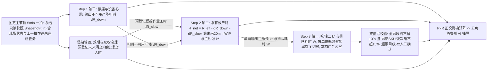
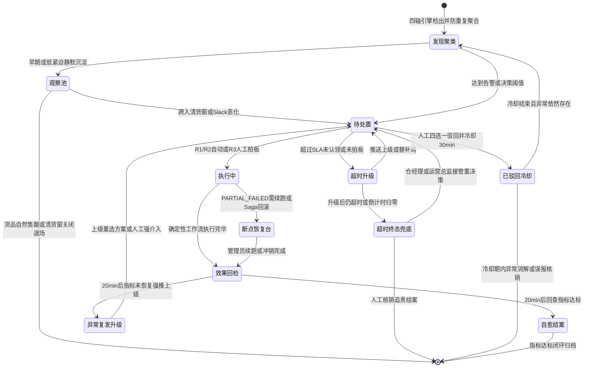

# 零壹 AI-Native WMS · S1 每日巡检与异常自愈 Agent 产品需求分析文档（PRD v1.0）

## 1. 文档元信息与版本冻结状态

| 项目 | 内容 |
| :--- | :--- |
| **产品载体** | 零壹仓储管理系统（`zero-one-10wms`） |
| **目标行业画像** | **电商快消仓**（食品饮料、美妆个护、日化快消；高频大促波峰、刚性平台截单、强效期/允收期约束） |
| **多 Agent 架构模式** | **Supervisor-Worker**（底座确定性执行 + 决策层 Agent 协同） |
| **核心交互载体** | **形态 B · 全局右侧 AI 抽屉**（左侧 RBAC 菜单 + 中间角色专属原生页 + 右侧零泄露 AI 抽屉） |
| **交互原型定稿基准** | `./s1_prototype_minimal_slice.html`（v3.1 纯离线单文件版） |
| **数据库核实基线** | `../02、项目需求/数据库/zowms.sql`（182 张表） / `../02、项目需求/数据库/zowms_views.sql` |

### 1.1 双版本冻结声明（工程纪律基线）

> [!IMPORTANT]
> 本 PRD 严格采用 **“业务与交互先行冻结，运行态待数据库改表后冻结”** 的双轨基线，防止拿理想数据假设硬套现有残缺表结构。

| 冻结子版本 | 包含内容 | 当前状态 |
| :--- | :--- | :---: |
| **`S1 v1.0 · 业务与交互`** | 全项目编号体系、P×R 正交矩阵、五角色全栈权责、安全急停旁路、R3 超时终态、四轴业务模型与算式、异常全生命周期、形态 B 交互规范（原型 v3.1）、成对验收 KPI | **✅ 正式冻结** |
| **`S1 v1.0 · 运行态`** | 七字段缺口补齐方案、冷启动降级模式、软心跳实际粒度（作业区/作业人级）、4 项切换日退出条件 | **⏳ 挂起（TBD，见第 9 章）** |

**版本变更记录**：
- **`v1.0 评审版`**：经 4 轮业务、运行态与原型压测评审，已统一软心跳三条件判据、闭合异常状态机出口、补齐回检升级接收方、明确五角色全栈 RBAC 隔离与实施顺序。**已知未决项**：① `S1 v1.0 · 运行态`（TBD-1~4，待数据库改表后冻结）；② 底座 B（S1/S5 共用五维版本化策略引擎，独立立项排期）；③ §11.3 系统级整体降级开关的 `N/M` 具体熔断阈值（待压测标定）。

### 1.2 全项目固定场景编号（评审唯一口径）

为防止跨模块评审时编号漂移，全局锁定 6 个固定编号：
- **S0（公共底座）**：主数据消歧（24 个公用接口）、版本化策略引擎（拆单/罚则/允收/费率）、效期可信度底座、风险经济账引擎、消息中间件协同
- **S1（本文档范围）**：每日巡检与异常自愈 Agent
- **S2**：入库预约与智能上架 Agent
- **S3**：出货履约与智能波次 Agent
- **S4**：盘点差异归因与库内调优 Agent
- **S5**：计费核对与经营洞察 Agent

---

## 2. 业务背景与产品核心原则

### 2.1 电商快消仓的 4 个核心业务痛点
1. **截单 SLA 极度刚性**：电商仓的一天由多个平台/承运商截单时刻 $T$（如 10:00 当日达、14:00 次日达、16:00 快递主截单、20:00 晚班截单）切割；延迟不仅产生单单违约金，一旦全店延迟率突破考核红线（如 >3%），更会触发巨额阶梯附加罚金与店铺降权。
2. **允收期比保质期更致命**：大平台（京东自营、天猫超市等）要求入仓签收时**剩余保质期必须大于总保质期的 2/3 或 1/2**（行业称 1/3 或 1/2 允收期）。传统“到期前 30 天亮红灯”为时已晚，货物在库房未腐坏前即已沦为大渠道拒收的死货。
3. **进出库与作业工序高度串联耦合**：月台`收货未上架`积压会直接导致`出货异常`缺货；拣货、复核、装车串联作业，任一节点设备/人员停摆几十分钟即可拖垮整波截单。
4. **大促与日常人力构成断崖式波动**：大促期间临时工占比达 40%~60%，效率仅为熟练工 50%~70%；且剩余待办单呈现“前期好单快、后期硬骨头难单越干越慢”的强非线性特征。

### 2.2 典型班次走查：电商快消仓的一天（S1 真实运作叙事）

> [!TIP]
> 在进入冷硬的数学与状态机规格前，先按时间轴走完一个典型电商快消仓班次，直观呈现 S1 如何在各角色之间静默运转与协同闭环：

- **08:30 · 开机慢拍巡检**：轴四慢拍扫描全仓效期与预留池。一批脱脂牛奶在京东预留池已满 6/7 天无需求，向**店铺运营**右侧抽屉静默推送 `R1` TTL 到期留痕通知（运营如备战大促可一键发起 `R2` 72h 锁定期豁免）；同时把短保高风险存量推入当日抽检池，并将抽检/清货工时预登记进轴二产能预算。
- **10:00 · 当日达截单前瞻调度**：5 分钟主拍发现 20 分钟后复核 WIP 即将溢出，系统依据 TOC 瓶口逻辑向**调度主管**推送 `R2` 内部调岗建议（从拣货组抽调 1 人支援复核，受单次 ≤20% 幅度锁与 20min 观察窗锁约束），平稳度过早波峰。
- **14:15 · 16:00 主截单生死时刻（跨三轴联动）**：
  1. **轴三捕获停摆**：常温复核员张三连续 5 分钟产出断崖进黄灯看板（不打扰）；至第 15 分钟且满足“相对个人基线 <30% + 积压斜率为正 + 同组李四/王五产出正常”三条件，触发 `P0×R1` 红灯停摆排查卡推送给**班组长**，并同步向轴二单向扣减 `-1 人效`；
  2. **轴二定位瓶口 + 轴一算经济账**：轴二结合减员算出待复核段 286 单告急；轴一倒推出 105 单缺口，并在「算式溯源」中发现纯切线方案 A 会把全店延迟率推至 5.25%（触发 `¥5,000` 阶梯罚金，总成本 `¥6,260`），而方案 B 呼叫外包 4 人×3h（受 15:30 装车截止最多多救 82 单，余力顺接晚班）可将延迟率压至 1.15%（含外包总成本 `¥1,956`，省 `¥4,304`），向**调度主管**推送 `P0×R3` 经济账决策卡；
  3. **多角色并行闭环**：**班组长**认领停摆并勾选现场真实外设异常；**调度主管**花 10 秒核对算式与原单锚点拍板方案 B（确定性工作流自动锁单改派，若中途失败进 Saga 恢复台）；**客服**右侧抽屉随即收到仅归属自己客户的 23 单延误报备模板，确认后经 `S0` 消息中间件异步外发；与此同时，**店铺运营**在其完全隔离的品牌门户里拍板了京东华北仓允收灰区（$P_{\text{拒}}=42\%$）的赌发决策。
- **14:40 · 20 分钟效果回检**：系统自动回查真实流水——张三复核产出恢复至 39 单/时、待复核 WIP 拐头降至 164 单，两张卡片均转为「自愈结案」并计入净自愈率分子；若某项未恢复则自动标红复发升级。
- **20:00 · 晚班交接复盘**：**管理层**驾驶舱（全天无琐碎弹窗打扰，仅在 P0 超时终态时介入熔断）自动汇总当日战果：9 条净自愈、1 条复发升级、预留池成对指标健康、万单罚金率较基线下降 34.2%、四类驳回归因同步进入下周阈值校准。

### 2.3 四条不可违背的设计铁律
1. **底座确定性 + 决策 Agent 化**：约三分之二（按零壹 WMS 功能清单中系统管理、七类配置表及基础资料常规 CRUD 接口占比测算）的确定性操作不 Agent 化，作为规则底座与参数校验库；Agent 只切入深调用链、跨模块归因、动态权衡决策。
2. **静态安全硬红线由确定性代码一票否决**：温层隔离、承重/容量、渠道禁拆单、禁止违规跨池分配等硬规则绝不依赖 Prompt 约束，所有 AI 主方案与折中方案均强制穿过硬规则校验网关。
3. **严禁大模型心算金额与库存**：一切费用、罚金、剩余保质期占比、WIP 数量必须由后端确定性代码/SQL 计算，模型仅负责推理编排、异常归因与解释，并强制提供可心算的「算式溯源」。
4. **全栈 RBAC 权限继承与零泄露**：所有工具调用严格透传当前登录用户的 WMS 角色与数据权限；不同角色看到完全隔离的菜单、主业务页与 AI 卡片，界面绝不暴露越权页面或“您无权查看某卡片”的泄露占位符。

---

## 3. 多 Agent 协作边界（Supervisor ↔ S1 巡检 Worker）

在整体 **Supervisor-Worker** 架构下，S1 作为专职 **巡检与异常自愈 Worker** 运行，具备双驱动入口：
- **主动驱动**：按固定决策节拍（默认 5 分钟一拍）与慢拍/事件触发自动执行四轴巡检，生成结构化异常与决策卡，经权限过滤后推送至各角色右侧 AI 抽屉。
- **被动驱动**：当调度主管/运营/管理层在右侧抽屉发起自然语言追问（如“为什么 16:00 波次复核台慢了？哪些单今天肯定发不出？”），Supervisor 路由至 S1，直接复用最新只读快照回答，避免重复重查压垮数据库。

**跨场景协作归属（严格防越权越界）**：
- S1 内部闭环：四轴监测诊断、节点停摆排查、波次切线经济账、内部调岗建议（R2）、在途允收灰区决策、临期观察与清货触发、20 分钟效果回检。
- 跨场景联动移交（经 Supervisor 或确定性工作流调用）：
  - 收货入口准入评分与折价特采 → 归 **S2**；
  - 渠道门槛降序预留池的出库批次分配引擎 → 归 **S3**；
  - 盘点差异过账与深度流水溯源 → 归 **S4**；
  - 客户通知外发与策略版本管理 → 归 **S0**（明确职责切分：**延误/临期对外通知决策卡由 S1 生成并按 RBAC 路由至客服/运营角色拍板，底层外发动作统一由 S0 消息中间件异步执行**）。

---

## 4. 风险治理模型：安全旁路 × P×R 正交矩阵（✅ 已冻结）

### 4.1 独立安全急停旁路通道（Safety Bypass）

> [!CAUTION]
> **PLC 急停、输送线防碰撞、紧急断料**等物理安全动作**不得进入 R3 人工审批矩阵**。其核心风险不在“做错”（重启即可逆），而在“做慢”（等 10 分钟审批货已撞毁或引发人身伤害）。该类动作走独立安全旁路：**硬代码毫秒级自动触发 + 事后强通知调度与运维**。

### 4.2 P（业务紧急度）× R（错误可逆性与资产/对外风险）正交矩阵

业务紧急度 **P 轴** 与 自治风险等级 **R 轴** 完全正交，严禁将 `P0` 等同于 `R3` 或“高自治”：

| | **R0（只读诊断 · 全自动）** | **R1（内部/可逆草稿 · 自动+留痕可撤）** | **R2（现场计划 · 静态红线+动态降级）** | **R3（不可逆/对外/资金 · 强拍板+超时终态）** |
| :--- | :--- | :--- | :--- | :--- |
| **P0（分钟级止血）** | `[S1]` 停摆三项排除取证 | `[S1]` 冷链超温告警、作业节点停摆排查推送、爆品月台加急上架提醒 | `[S1]` 高避损率单插队抢救、未来 20min 瓶口内部调岗支援 | `[S1]` 截单切线认赔与呼叫外包决策、`[S0/S1]` 延误客户报备外发 |
| **P1（小时级履约）** | `[S1]` 效期可信度核查、在途灰区被拒概率测算 | `[S1]` 低可信短保强制抽检任务、预留池 TTL 将到期释放留痕通知 | `[S1]` 预留池大促锁定期豁免 TTL、`[S2/S3]` 动态储位/波次推荐与晚班跨区降级 | `[S1]` 合规拆单拍板、在途允收灰区(20%~80%)赌发/止损决策、临期清货货主函、`[S2]` 收货折价特采+打渠道标 |
| **P2（日级资产优化）** | `[S1]` 效期早期观察池静默跟踪、供应商迟到月度复盘 | `[S1/S4]` 常规理货腾位草稿、常规低可信存量滚动抽盘 | `[S4]` 跨日库位碎片整理计划 | `[S4]` 大额盘点差异过账 |

### 4.3 R2 动态负载与防抖铁律
1. **已派发任务绝对锁定**：动态负载仅作用于“待分配新单队列”，严禁因负载瞬间波动自动撤回已派发/已接单任务。
2. **双阈值迟滞带 + 滑动窗 + 冷却期**：弃用秒级瞬时人数；负载采样基于滑动窗口，设置高低双阈值缓冲带（如负载 >85% 持续 10 分钟降级，<70% 持续 15 分钟恢复）与切换后最小冷却期，消灭临界点“反复横跳”。
3. **折中方案硬红线一票否决**：AI 提出的任何降级折中方案（如临时暂存缓冲位）必须与主方案穿过同一套确定性硬规则网关（温层、承重、暴露时长）；若全部折中方案均触红线，直接上报无解交人工协调。

### 4.4 R3「参谋长 + 执行官」全闭环铁律（区别于传统 OA 审批）
- **审前防漏查（硬编码必查 Checklist + 缺证熔断）**：每个 R3 场景的数据源清单由代码硬编码写死，绝不靠 LLM 临场决定查哪些表。任一必查表查询超时或缺失，卡片标红并**物理禁用“批准执行”按钮**。
- **审前防盲批（证据锚点 + 算式溯源 + 权责归属）**：
  - 业务签字权与最终责任归属审批人；
  - 每条关键事实挂可点击的原始单据只读快照锚点；
  - 金额对比必须展开「算式溯源」（含第 0 行数量推导、前提假设声明、最坏损失暴露）。
- **超时强制终态（Timeout Fallback，绝不静默变绿）**：
  - 每个 R3 卡片均设真实倒计时 SLA；超时未决先自动升级上级（如 10~15min 升级仓经理/运营总监）；
  - 升级后仍未拍板或倒计时归零，**系统强制执行预设终态并在看板标红**：
    - *作业/拆单/灰区类* → 执行**最保守可逆动作**（不拆单、不改承诺、临时挂起发运防误发被拒）+ 标红待追责；
    - *截单认赔类* → 锁定延误名单与报备草案（**严禁擅自外发客户消息**）+ P0 强推仓经理接管。
- **批后确定性执行（脱离 LLM + Saga 断点恢复台）**：
  - 审批人点击确认后，控制权立即脱离 LLM 移交确定性工作流引擎；
  - **主/副异步解耦**：核心账务/单据落库为同步主链路，外部短信/邮件/站内通知走`消息中间件`异步重试队列，杜绝通知超时拖垮主事务一致性；
  - **幂等 + Saga + 断点恢复**：分配唯一 `Execution_ID` 幂等键，记录各步执行状态；核心步骤中途失败自动带幂等键重试，重试失败时可逆步骤自动 Saga 回滚，不可逆步骤置为 **`PARTIAL_FAILED`**，冻结后续步骤并告警管理员进入断点恢复台（支持一键【幂等续跑失败步】或【Saga 补偿回滚】）。

---

## 5. S1 核心引擎：决策节拍与四轴业务规格（✅ 业务逻辑冻结）

### 5.1 固定决策节拍与单向无环数据流

为斩断 `轴一 ↔ 轴二 ↔ 轴三` 循环依赖并消除轴四与主拍的产能争夺，S1 严格按 **固定节拍 + 快照冻结 + 单向推演 + 双阻尼** 运作：

- **快照完整定义**：`Snapshot(t_n)` 必须同时冻结 **实时现场队列状态** 与 **上一拍已下发但尚未完成的在途任务（In-Flight Tasks）**，轴二扣除已占产能，轴一剔除已进抢救队列单，杜绝重复抢救。
- **双阻尼规则（防全局与局部震荡）**：同时校验 **全局单周期改判占比 ≤ 10%** 与 **局部（按 SKU 组 / 波次组）单周期改判占比 ≤ 15%**。阻尼超限时**不硬截断**（防止真实突发加急单被锁死），直接降级为 R2 人工确认卡片。

---

### 5.2 轴三 · 全仓作业停摆与设备心跳
1. **硬心跳（明确硬件/协议探针）**：对接`温度维护`传感器、以及后续接入的 PLC 故障回执/打印网关/WCS 接口；有明确错误码或持续超温（过滤开关门瞬时抖动）才输出明确硬件故障定性。
2. **软心跳（WMS 作业流水异常反推）**：
   - **三条件触发判据（防止把找单/上厕所误报为停摆，直接兜住 §10 假阳性 <8% 红线）**：
     - ① **相对个人基线断崖**：作业产出速率跌至**该作业人/节点自身历史基线的 <30%**（严禁使用“绝对 15 分钟产出=0”的一刀切判据）；
     - ② **积压斜率为正**：名下或本段待办队列的**增长斜率 > 0**；
     - ③ **同区对照正常**：同作业区其他节点产出正常（若全区/全段齐停，则直接归类为全段停摆并自动抄送 IT 排查接口/网络/共用服务）。
   - **双层黄红灯呈现**：满足异常迹象满 **5 分钟**亮黄灯（仅入看板不弹窗打扰）；持续 **15 分钟且上述三条件同时成立**才升红灯推送班组长排查卡。
   - **措辞铁律与前置排除法**：在未接入打印/WCS 硬件探针前，**严禁直接定性为“打印机故障”**，统一输出客观事实 **「节点作业异常停摆，请现场排查」**，并随卡附带三项前置排除证据：① **时段核验**（过滤饭点/交接班静默窗）；② **上游供货核验**（排除上游断供）；③ **范围对照**（区分单点停摆 vs 全段系统故障）。
3. **向轴二单向输出**：将确认停摆的工位/作业人产能实时换算为不可用产能扣减量 $\Delta R_{k}^{\text{down}}$ 传入轴二。

---

### 5.3 轴二 · 真实有效产能与未来 20 分钟前瞻瓶口
1. **按当班技能构成算有效产能（防大促新工断崖）**：
   $$R_k^{\text{eff}} = \sum_{s \in \{\text{熟,半熟,新}\}} N_{k,s} \cdot \eta_s \cdot r_{k,\text{base}}$$
   *（注：$\eta_s$ 依赖 `TBD-1` 轻量排班技能表；冷启动期统一按 $\eta_s = 1.0$ 处理并走 `TBD-1` 降级公式，随技能表上线后解冻启用。）*
   扣减轴三停摆与轴四慢拍预登记后得净有效产能：
   $$R_k^{\text{net}} = \max\left(0,\ R_k^{\text{eff}} - \Delta R_k^{\text{down}} - \Delta R_k^{\text{slow}}\right)$$
2. **按复杂度加权工时（Work Units）破解“越干越慢”**：剩余待办单按结构分桶（一单一货极简桶 / 2~5 SKU 常规桶 / 跨区多品大件硬骨头桶）分别乘以对应基准工时，彻底杜绝拿前期爆品平均单速线性外推导致的过度乐观。
3. **前瞻未来 20 分钟 WIP 瓶口定位（缓冲管理）**：
   $$\widehat{\text{WIP}}_k(t + \Delta t) = \text{WIP}_k(t) + \left(R_{k-1}^{\text{net}} - R_k^{\text{net}}\right) \cdot \Delta t \quad (\Delta t = 20\text{min})$$
   定位即将溢出的主瓶颈工序 $k^*$ 与各段排队耗时 $W_{i,k} = \text{WIP}_k / R_k^{\text{net}}$，输出给轴一；并依据约束理论（TOC）建议调岗方向（例如复核瓶口时绝不加派拣货，改为抽拣货支援复核）。
4. **调岗稳定性三锁（防瓶口震荡“摇桌子”）**：
   - **幅度锁**：单次从某工序抽调人数 $\le$ 该工序在岗人数的 **20%**；
   - **观察窗锁**：调岗生效后 **20 分钟内禁止反向回抽**（除非触发 P0 硬件停摆）；
   - **震荡熔断**：60 分钟内同一对工序出现 $\ge 2$ 次反向调岗趋势 → 自动熔断内部调岗建议，上报主管评估外包增援或切波次。

---

### 5.4 轴一 · 波次动态切割与经济账引擎
1. **完整剩余耗时与动态状态判定（废弃死常量 `T-4h/T-2h/T-30min`）**：
   $$E_{\text{rem}}(i) = \sum_k \left(W_{i,k} + P_{i,k}\right), \qquad \text{Slack}_i = (T_{\text{截单}} - t_{\text{当前}}) - E_{\text{rem}}(i)$$
   - `Slack > 0` → 常规履行态；
   - `Slack <= 0` → 进入产能饱和下的机会成本排序切线。
   - **单拍估计偏差声明**：$E_{\text{rem}}$ 与排队耗时 $W_{i,k}$ 基于拍初冻结快照 `Snapshot(t_n)` 测算；本拍切线或调岗执行后现场队列随即变化，因此天然存在 **1 个节拍周期（5min）的估计偏差**，由下一拍快照 `Snapshot(t_{n+1})` 自动校正，拍内严禁回写震荡。
2. **纯可量化延误总损失（统一“元”量纲，剔除货值与无量纲 VIP）**：
   $$L_i = \text{平台单单违约罚则}_i + \text{店铺延迟率阶梯边际罚金}_i + \text{客户LTV折算损失}_i + \text{内部返工成本}_i$$
   *(说明：商品货值归货主所有，不作为延误收益主项，仅在丢失/损毁风险时作附加系数；店铺延迟率阶梯边际罚金确保低价高频爆品不会因单单便宜而被误放弃。)*
3. **单位瓶颈工时避损率排序切线（解决饱和分母爆炸）**：
   $$\rho_i = \frac{L_i}{t_{i,k^*}}$$
   按 $\rho_i$ 降序装入主瓶颈剩余可用工时容量 $C_{\text{rem}}(T)$（同时受下游装车截止时间等物理上限约束），自然划出 **生死切割线**：
   - **切线以上**：保发/抢救队列；
   - **切线以下**：直接进入认赔善后队列（生成延误名单与客服报备草案 + 顺延下一截单波次）。
4. **外包增援经济账比选**：联动计费模块`外包装车费`/`外包卸货费`单价，将「不加外包纯切线（含可能触发的全店阶梯附加罚金）」与「呼叫外包增援（注明物理承接上限与余力顺接晚班）」并排测算，给出含 0~3 行完整公式的「算式溯源」（明确写清“本日全店总单量”及“假设其余订单零延误”前提）。
5. **平台/客户拆单合规硬闸门**：AI 拟输出拆单降级方案前，必须先过底座 B 拆单白名单硬规则校验。禁止拆单的平台/客户（如京东自营整单齐套、组合套装）**物理禁止输出拆单选项**；合规可拆的归 R3，须核算“新增快递运费 vs 避免罚款”。

---

### 5.5 轴四 · 效期与允收期全生命周期治理

#### 5.5.1 三大前置底层底座（归 S0 公共能力）
1. **底座 A · 效期数据可信度分级**：
   - 区分 **高可信**（条码扫描/质检复核）、**中可信**（供应商声明）、**低可信**（人工手录 / 退货回仓 / 生产日与到期日混用风险）。
   - **角落强规则（低可信 + 短保 + 高门槛渠道）**：严禁留黑洞 → 强制三联处置：① 生成最高优抽检复核（P1×R1） ② 复核完成前临时降渠道锁定（禁发高门槛） ③ 超时未检转调度与运营人工决策。
2. **底座 B · 版本化策略引擎**：
   - 统一托管 **平台允收规则、拆单白名单、延迟阶梯罚则、仓储费率（S5 同构）**，按 `平台 × 仓库 × 品类 × 合同版本 × 生效时间` 维护，严禁静默覆盖历史版本，支持历史批次按入库当时规则回溯。
3. **底座 C · 三段式时变线路时效分布**：
   - 拆分为 **`干线运输` + `平台预约等待` + `入库验收`** 三段独立统计（分别取 P90/P95 分位，区分不可控干线与可前置优化的预约 ASN），取数窗口采用 **近 30 天滑动窗 + 大促/平日日历切换**。

#### 5.5.2 五项全链路机制
1. **源头准入评分（S2 挂钩，最大杠杆前置）**：收货入库扫入生产日期时即评估清货概率，基础口径为 $\text{准入评分} = f(\text{剩余保质期},\ \text{可触达清货日速区间},\ \text{预计到仓时点})$（具体权重与分档阈值归 S2 PRD 详述）。不达标批次主路径为 **「折价/特采收货（R3） + 强制打渠道限制标（隔离高门槛池） + 计入供应商考核」**；**拒收**退位为极端兜底（仅触发于 `低可信 + 短保 + 无清货渠道/无人认领` 三合一死货）。
2. **渠道门槛降序预留池 + TTL 机制（S3 挂钩，改写分配引擎）**：
   - **规则升级**：`FEFO` 从第一硬排序键**降级为同门槛池内二级排序键**；第一排序键为**渠道允收门槛降序**（高门槛京东/猫超 >2/3 优先锁定高剩余效期批次，低门槛抖音/C 店禁止跨池消耗预留库存）。
   - **防呆滞 TTL**：高门槛预留池按渠道平均下单间隔配 **TTL**（如 7 天）；超期无高门槛需求自动降级释放至下一档池，**必留痕 + 通知店铺运营（R1）**。
   - **大促锁定期豁免（R2）**：店铺运营可发起带明确起止时间的 **R2 大促锁定豁免 TTL**，到期自动解锁。
3. **在途被拒两档经济红线（复用轴一经济账引擎）**：
   - 基于底座 C 算出到仓被拒概率 $P_{\text{拒}}$：
     - $P_{\text{拒}} > 80\%$ → **硬红线直接拦截**；
     - $20\% \le P_{\text{拒}} \le 80\%$（经济灰区）→ 复用经济账引擎测算，**严格闭合被拒后回仓转清货口径**：
       $$\text{赌发预期损失} = P_{\text{拒}} \times \left(\text{往返运费} + \text{回仓转清货折损}\right) \quad \text{vs} \quad \text{直接拦截转清货折损}$$
       输出带算式溯源的 R3 卡片，由店铺运营留痕拍板。
4. **响应式清货与反“临期标签自我实现”**：
   - 弃用平稳滑动均值预测，改用 **P10 悲观 / P90 乐观区间** + **大促活动日历同期对齐**；真实脉冲成交事件一到立即重算退出清货池。
   - **短保/长保统一预警公式（分母区间化，消除假精确）**：
     $$\text{预警提前量区间} = \frac{\text{当前库存}}{\text{可触达清货日速}_{[\text{P10},\ \text{P90}]}} \times \text{安全系数}$$
   - **可见性分层**：触达悲观上限仅静默入「观察池」，跨入可清货窗口再升级为运营待办。
   - **打破临期标签自我实现**：基线测算剔除标记后的销量衰减；清货动作**严禁将货挪至偏远角落降低优先级**，而是反向给主推曝光位/加价购/清货主渠道。
5. **退货效期硬隔离（直连底座 A）**：因客户持有期不可知，所有退货入仓默认打标为底座 A **「低可信效期」**，强制独立库位与独立批次隔离（禁混正品）、质检重验并适用更严允收门槛。

---

## 6. 异常全生命周期状态机与闭环治理（✅ 已冻结）

### 关键闭环规则
1. **结构化四选一驳回（校准唯一输入）**：人工驳回决策卡必选四项之一——`[1. 数据错]` / `[2. 规则错]` / `[3. 现场特殊]` / `[4. 模型错]`（可附备注），确认后立即进入 **30 分钟同批次冷却静默**，避免反复弹窗骚扰，并汇总至管理层校准看板。
2. **20 分钟效果回检闭环**：所有处置执行/现场上报完成后，20 分钟自动回查真实业务流水（如待复核 WIP 是否拐头下降、断流人员是否恢复复核产出）：
   - **回检达标** → 置为「自愈结案」，计入净自愈率分子；
   - **回检未达标** → 置为「处置无效/复发」，自动强升级调度主管或仓经理介入。

---

## 7. 五角色全栈 RBAC 权限切面与形态 B 交互规格（✅ 已冻结）

交互形态正式锁定为 **形态 B · 全局右侧 AI 抽屉**，所有界面行为以定稿原型 `./s1_prototype_minimal_slice.html`（v3.1）为唯一交互验收标准。

### 7.1 五角色全栈 RBAC 隔离矩阵

| 角色 | 门户定位语言 | 左侧授权菜单 | 中间专属主业务区 | 右侧 AI 抽屉卡片与专属动作 | 严格物理屏蔽范围 |
| :--- | :--- | :--- | :--- | :--- | :--- |
| **1. 调度主管** | 仓内运营端 · 调度视图 | 系统首页`[S5]`、每日检查`[S1]`、装车复核`[S1主视图]`、任务确认/波次`[S3]`、收货未上架`[S2]`、库内转移`[S4]`、月台计划`[S2]` | 3 段粗粒度 WIP 水位条 + 全仓在途复核队列 | 1. **停摆产能联动卡**（只读班组长进度 + 专属 **`R2 抽调支援`**，受 ≤20% & 20min 观察锁） 2. **停摆回检复发卡**（承接班组长上报后 20min 未恢复的升级事件） 3. **轴一截单切线经济账卡**（R3 拍板、算式溯源、Saga 恢复台、20min 回检） | 不抢班组长现场认领；屏蔽公司财务总账与非仓储商务定价 |
| **2. 店铺运营 / 商务** | 货主/运营协同门户（非全仓 WMS） | 我的货品效期`[S1]`、渠道预留池与 TTL`[S1主视图]`、平台允收规则版本`[S0]`、履约灰区协同`[S1]` | 仅限本品牌/货主渠道效期池 + 重点监控批次表 | 1. **轴四允收灰区经济账卡**（R3 拍板赌发 vs 转清货，闭合回仓折损算式） 2. **预留池 TTL 到期留痕通知**（R1 通知 + **`R2 大促锁定豁免`**） | **完全不可见**全仓 WMS 作业菜单、库位号、复核人名单、WIP 与其他货主数据 |
| **3. 班组长 / 仓管员** | 现场作业端 · 班组执行视图 | 收货登记`[S2]`、下架拣货`[S3]`、装车复核(本组)`[S1主视图]`、库内转移`[S4]`、动碰盘点/抽检`[S4]` | 本班组人员流水心跳与待办任务表 | 仅显示 **轴三节点停摆排查卡**（P0×R1：**`认领现场排查`** + **中性无引导多选根因上报** + 20min 回检） | **完全屏蔽**所有货值、罚金、外包单价、LTV 与 R3 经济账卡片（零占位泄露） |
| **4. 财务 / 客服** | 客服与计费协同视图 | 异常出库客户影响表`[S1主视图]`、消息中心`[S0]`、客户账单`[S5]`、费用明细`[S5]` | 联动调度切线结果的待沟通延误客户清单（仅归属客户） | 仅显示 **R3 对外延误道歉/补偿通知确认卡**（预填消息模板，一键经`消息服务`异步外发） | 不可见库内调岗、停摆排查与预留池内部策略 |
| **5. 管理层 / 仓经理** | 管理驾驶舱 · 治理与熔断视图 | 系统首页`[S5]`、S1 巡检治理与验收 KPI`[S1主视图]`、费用合计`[S5]`、全局策略与预算上限`[S0]` | S1 成对验收 KPI 大盘 + 底座 A 爬坡进度 + 四类驳回归因分布 | 默认静默零打扰；仅在 **P0/R3 超时终态** 或 **处置 20min 回检未达标复发升级** 时弹出 **红框紧急接管卡**；缺证熔断时仅作只读透明提示 | 默认屏蔽基层高频作业与 R1/R2 琐碎卡片 |

### 7.2 核心交互组件刚性规范
1. **顶栏运行模式指示器** `[依赖 TBD-1~4，交互占位与弹窗形态已冻结，具体切换条件项随 S1 运行态一并冻结]`：常驻展示当前运行阶段（如 `🟡 冷启动 D+12 / D+28 · 未达切换条件`），点击弹窗透明展示 4 项切换退出条件实时进度。
2. **经济账决策卡标准骨架（轴一/轴四共用）**：
   - 顶栏：`P×R` 双徽章 + 场景标 + **实时走秒 SLA 倒计时**（归零自动转超时终态变红，绝不静默）；
   - 证据层：可点击单号弹窗查看只读原始单据快照 + 4 项硬编码必查清单（任一项失败即物理禁用审批按钮）；
   - 计算层：可折叠 **「算式溯源」**（含第 0 行缺口推导、前提假设声明、全套金额可心算闭合）；
   - 动作层：多方案单选对比 + 批准（进入确定性工作流 / Saga 恢复台 / 20min 回检终态） + 四选一结构化驳回。
3. **节点停摆排查卡标准骨架**：
   - 双动作集严格分离（调度主管调岗支援 vs 班组长认领排查）；
   - 必须展示 **三项前置排除法** 取证结果；
   - 班组长根因上报采用 **中性无引导多选**（不得将“人员离岗”置顶暗示），提交后自动进入 20min 回检终态。

---

## 8. 零壹 WMS 真实数据库核实与缺口清单（Step A 实证）

基于 `../02、项目需求/数据库/zowms.sql` 全量 182 张表 DDL 逐字段核实，7 项核心数据依赖现状如下：

| # | 所需数据 | 业务用途 | 零壹 WMS 现状 | 真实 DDL 核实结论 |
| :-: | :--- | :--- | :---: | :--- |
| **1** | **排班技能等级** (熟/半熟/新工) | 轴二算有效工时 $R_k^{\text{eff}}$ | **❌ 无** | 仅有 `t_s_base_user`、`t_s_user`、`ba_work_sta`，无排班表、无班次人数、无技能/入岗系数。 |
| **2** | **各工序实时 WIP** | 轴二排队耗时 → 轴一 Slack | **⚠️ 部分有** | 有 3 段粗粒度表：`wm_om_qm_i`（待下架）、`wm_to_down_goods`（下架）、`wm_om_delv_h/i`（装车复核）及 `wave_*` 视图；**缺打包/分播段、作业开始时间与工位编号**（仅有 `assign_to`/`fh_user` 人维度）。 |
| **3** | **生产日期采集方式与采集率** | 底座 A 效期可信度 | **❌ 无** | `wm_in_qm_i.pro_data`、`md_goods.bzhi_qi` 存在，但**无扫码/质检/手录/退货来源标记**；单 SKU 仅单一保质期值，无生产日/到期日口径字段。 |
| **4** | **线路×平台×目的仓签收时点（三段）** | 底座 C 时效分布 | **❌ 无** | `wm_om_notice_h` 仅有 `delv_data`；`tms_yw_dingdan` 仅有单一粗糙 `sdsj`；**全缺干线/预约/验收三段及平台 ASN 回执**。 |
| **5** | **平台允收/拆单/罚则配置** | 底座 B 版本化策略 | **❌ 无** | 全库 182 张表无结构化平台允收比例、拆单白名单、阶梯罚则及版本生效时间表。 |
| **6** | **出库单渠道标识** (京东/猫超/抖音/C店) | 渠道门槛预留池 | **⚠️ 部分有** | `wm_om_notice_h` 无原生 `channel_code`，仅有 `cus_code`、`ocus_code`（三方客户，B2B 可暂映射）、`order_type_code`、`pi_class`。 |
| **7** | **设备状态接口** (PLC回执/打印网关/WCS) | 轴三硬心跳 | **⚠️ 极弱部分有** | `wms_plc` 仅静态指令配置，无故障/在线回执；`wm_wendu` 有温度值；无打印机网关/DWS/分拣线心跳表。 |

---

## 9. ⏳ 挂起项：`S1 v1.0 · 运行态 TBD 清单`（待数据库改表阶段冻结）

> [!WARNING]
> 本章 4 项内容因强依赖后续零壹 WMS 数据库表结构改造，**当前显式保持挂起（TBD）状态**，待建表方案确定后逐项补齐并单独冻结 `S1 v1.0 · 运行态`：

| TBD 编号 | 挂起议题 | 建议冷启动降级策略（待改表确认） | 建议正式切换日退出条件（Exit Criteria） |
| :--- | :--- | :--- | :--- |
| **TBD-1** | **Slack 与产能冷启动** | 废弃恒等式伪公式，改用 **$V_{\text{actual}} = \text{近 30min 实测产出速率} \times 0.8$**（补偿“越干越慢”的已知非线性偏差），并在界面强制标注 **`[冷启动·乐观估计，实际缺口通常更大]`**；轴一关闭自动切线，降级为 3 段 WIP 红黄灯 + 人工拍板切线。 | 轻量排班技能表上线 **且** 积累 ≥14 天（含至少 1 次波峰）分复杂度实测工时，离线回测误差 < 20%。 |
| **TBD-2** | **软心跳实际监控粒度** | 基于 §5.2 已冻结的三条件判据与黄红双层呈现，按现有 DDL 现实将监控粒度下沉至 **作业人级（`assign_to`/`fh_user`）** 与 **库区/全段级**，严禁虚构不存在的工位号。 | 未来若 `wm_om_delv_h` 补齐工位号或接入打印/WCS 硬件探针，再升级至工位级硬心跳。 |
| **TBD-3** | **渠道预留池落地与影子模式** | 补建轻量逻辑预留池表与 `channel_code`；过渡期开启 **Shadow Mode（影子告警，不硬锁分配）**。 | 废弃可刷覆盖率指标，改为人工抽检 200 单验证：**渠道分类准确率 ≥ 98%** **且** **高门槛渠道（京东/猫超）识别率 ≥ 99%**，叠加 7 天影子核对无误后切硬预留。 |
| **TBD-4** | **存量 100% 未标记效期防瘫痪** | 将存量未标记单列为 `Legacy Unverified`（**不自动锁高门槛渠道防 Day 1 瘫痪**），仅对其中短保+高门槛+临近允收线 Top 存量滚动抽检；仅对切换日起新收货/退货的明确低可信执行强制锁渠道。 | 随快消周转与滚动抽检，货值加权高可信覆盖率爬坡至 ≥ 80%（预计 T+60 天），存量未标记退场。 |

---

## 10. 可量化验收指标体系（SLO / KPI，✅ 已冻结）

所有指标均采用 **成对防作弊 / 对照组去虚高 / 单量解耦** 口径，直接接入管理层 S1 治理大盘：

| 验收维度 | 指标名称 | 合格线（试运行 → 稳态） | 防作弊 / 口径约束 |
| :--- | :--- | :--- | :--- |
| **告警与推荐质量** | 软心跳停摆**假阳性率** | `< 15%` → **`< 8%`** | 按月统计且须满足 **月告警样本量 $n \ge 30$**，以班组长勾选误报核销计入 |
| | R2/R3 决策卡**人工采纳率** | `≥ 65%` → **`≥ 80%`** | 强制搭配四选一驳回原因分布统计（数据错/规则错/现场特殊/模型错） |
| | 冷却期内重复骚扰率 | **`= 0%`** | 驳回或执行后 30min 冷却期内同批次再弹率 |
| **响应与系统稳定性** | P0 异常 **MTTA / MTTR** | `MTTA ≤ 5min` / `MTTR ≤ 25min` | 发现至首次认领 / 发现至 20min 回检达标总耗时 |
| | **净自愈率**（核心） | `≥ 30%` → **`≥ 40%`** | **净自愈率 = 干预后 20min 恢复率 − 同类未干预对照组自然恢复率**（剔除自然恢复虚高） |
| | 双阻尼与调岗稳定性 | 全局改判 `≤10%` / 局部 `≤15%` / 震荡熔断 `<5%` 班次 | 验证系统防“摇桌子”与防局部震荡有效性 |
| **过程健康度（防失效）** | **R3 超时终态触发占比** | **`< 5%`** | 超时触发兜底数 ÷ 总 R3 推送数；偏高说明 SLA 定太短或推送触达/排班配置有缺陷 |
| | **20min 回检未达标率** | **`< 15%`** | 执行后 20min 指标仍未恢复的复发占比；直接监控处置方案真实有效性，防“只执行不治愈” |
| **效期与预留池健康** | 预留池**成对指标** | 命中率 **`80% ~ 92%`** **且** 高门槛缺供率 **`< 3%`** | **必须成对考核**，防止通过缩小预留池刷高命中率导致高门槛断供 |
| | 预留池 TTL 额外呆滞率 | **`< 2%`** | 验证 TTL 自动降级释放不制造新呆滞 |
| | 底座 A **效期高可信覆盖率** | **`T+60 ≥ 80%` · `T+120 ≥ 90%`** | 按 **在库货值加权** 计算（优先覆盖高价值核心库存） |
| | 临期/灰区**清货挽回率** | **`≥ 70%`** | 成功变现箱数 ÷ 进入可清货窗口总箱数 |
| **履约经济结果** | **万单罚金率**（或 `罚金 ÷ GMV`） | 较上线前同周期基线 **下降 ≥ 30%** | 与单量解耦，避免大促翻倍导致绝对罚金上涨误伤考核 |

---

## 11. 非功能需求与审计底线

1. **权限零绕过**：Supervisor 与 S1 Worker 调取任何零壹 WMS 接口必须透传当前会话用户 Token/RBAC 角色；定时巡检后台任务仅允许在受控只读/草稿权限上下文运行，严禁静默以超管身份执行 R3 写接口。
2. **全链路可回放审计**：每一张决策卡完整持久化留痕——`Snapshot_ID`、`策略版本号(底座B)`、`必查证据原始查询结果`、`算式参数与输出`、`审批人/操作时间/驳回原因`、`Execution_ID` 与各步 Saga 执行日志，支持任意财务/客诉追责时一键还原当时决策现场。
3. **性能、单点熔断与系统级整体降级开关（事中保险丝）**：
   - **单拍时限与单点熔断**：5 分钟主拍单次全量巡检计算耗时须控制在 **≤ 15 秒** 内；任意外部依赖或数据库查询超时，单点走「缺证熔断禁批」，严禁阻塞零壹 WMS 核心收发货主业务。
   - **系统级整体降级开关（防大促反成新堵点）**：提供自动熔断与仓经理手动一键总闸——当单位分钟告警量 `> N` 条、或全仓待决策队列积压 `> M` 条时（`N/M` 具体阈值待压测标定），S1 自动整体降级为 **「只采集留痕、停止推送决策卡与自动调度」**，平滑退回纯人工模式并强通知运维/仓经理，绝不允许巡检系统在大促雪崩时反向拖垮现场。
4. **快照与审计分级留存策略（控存储膨胀，288 拍/天 ≈ 8,640 份/月）**：
   - **全仓快照热存 7 天**：供 20min 回检与短期复盘毫秒级回放；
   - **决策卡证据链冷存审计**：仅存 `Snapshot_ID` 引用 + 命中的原单据精简快照切片，不冗余保存全仓队列；
   - **90 天后自动降维聚合**：全仓快照与原始流水聚合沉淀为日/波次级统计基线（保留历史 KPI 与趋势，释放热库空间）。

---

## 12. 实施顺序与前置依赖路线（含 Day 0 刚性任务）

为避免“等所有表改完再动工，结果上线时缺历史样本又白等两周”或低估公共底座复杂度，研发排期严格按以下顺序推进：

| 实施批次 | 核心交付事项 | 前置依赖与关键说明 |
| :--- | :--- | :--- |
| **Day 0（立即启动）** | **作业状态变更流水落库** | **全项目唯一“今天不做、明天就少一天数据”的刚性任务**，记录下架/复核/回单状态时间戳与作业人，为后续 14 天分结构工时与个人效率基线攒样本。 |
| **独立立项（前置并行）** | **底座 B · 五维版本化策略引擎** | 托管平台允收、拆单白名单、阶梯罚则与仓储费率（按 `平台×仓库×品类×合同版本×生效时间` 维护并支持历史回溯），属于 **S1 与 S5 共用核心前置项，单独立项排期**，绝不低估塞入“极轻扩”。 |
| **第 1 批（零/极轻改旧表）** | **轴三软心跳（三条件+黄红灯） + 存量效期分级滚动抽检** | 不依赖大改核心业务旧表；率先在右侧 AI 抽屉上线停摆排查卡与冷启动经济账决策卡（底座 B 上线前以临时受控配置表过渡）。 |
| **第 2 批（增量 DDL）** | **渠道预留池表（含 TTL） + `channel_code` + 轻量排班技能表** | 完成人工抽检 200 单达标（分类 ≥98%、高门槛 ≥99%）后，从影子模式切入硬预留池；同步解冻并冻结 `S1 v1.0 · 运行态`。 |
| **第 3 批（生态对接）** | **平台 ASN 三段签收时点（底座 C） + 打印/WCS 硬心跳探针** | 逐步将人工保守缓冲升级为近 30 天滑动窗三段 P90/P95 分布，将软心跳升级为软硬双保险。 |
